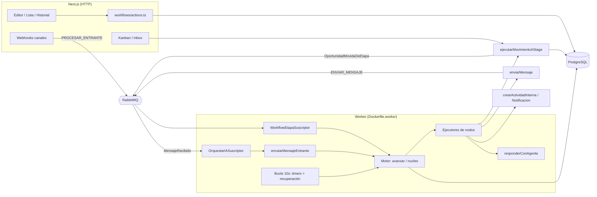
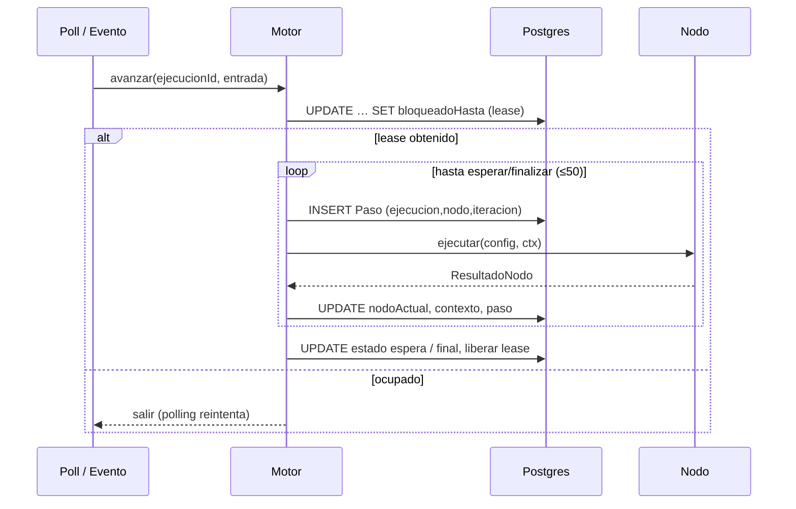
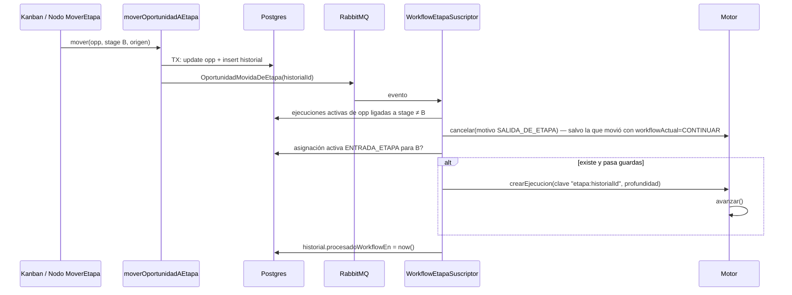

# Workflows en Karia — Informe de arquitectura y plan de implementación

> Estado: **propuesta para aprobación**. No se ha modificado código.
> Fecha del análisis: 2026-11-11. Todas las rutas son relativas a la raíz del repositorio.

## Resumen ejecutivo

- **Es viable y se recomienda como módulo interno** (`src/workflows/`) que corre en el **worker existente** (`src/worker/disparadores.ts`, `Dockerfile.worker`). No hay razón técnica para un microservicio: el worker ya es un proceso persistente con RabbitMQ y polling sobre Postgres.
- **Se reutiliza:** bus RabbitMQ (`ConsumidorBase`, `publicadorEventos`), patrón de jobs con `ejecutarEn`, evaluador de condiciones AND/OR (`evaluarArbol` + `ConstructorCondiciones`), `enviarMensaje`, `ejecutarMovimientoAStage`, la canalización completa de IA (contexto, herramientas, autonomía, `UsoIA`, `modoSimulacion`), `interpolarPlantilla`, auth/permisos (`requireSesion`, `requirePermisoAction`).
- **Nuevo:** 5 tablas (`Workflow`, `WorkflowVersion`, `WorkflowAsignacion`, `WorkflowEjecucion`, `WorkflowEjecucionPaso`) + `OportunidadHistorialEtapa` + `Notificacion`, columnas aditivas en `Conversacion`, `MensajeConversacion` y `ConfiguracionEmpresa`, editor con `@xyflow/react`.
- **Hay 5 brechas en el código actual que deben cerrarse antes (Fase 0)**; sin ellas el requisito "cambio de etapa → Workflow de la nueva etapa" y el control exclusivo de la conversación no se pueden garantizar. Todas se pueden corregir sin alterar el comportamiento visible actual (salvo una, que es un bug: la IA sigue respondiendo después de transferir a humano).
- **No afecta lo actual:** todo detrás de `ConfiguracionEmpresa.workflowsHabilitado = false` por defecto; con el flag apagado, Disparadores e IA por etapa siguen funcionando exactamente igual.
- **IA solo vía Workflow (D3):** en una empresa con Workflows habilitados, la IA atiende conversaciones **únicamente** a través del nodo Atención IA. La respuesta automática por etapa (`respuestaIAHabilitada`) deja de actuar para esa empresa (su configuración no se borra; apagar el flag la restituye).

---

## A. Diagnóstico del proyecto actual

### A.1 Stack real

| Capa | Hallazgo | Nota |
|---|---|---|
| Framework | **Next.js 15.5.18 instalado** (`package.json: ^15.5.18`) | `CLAUDE.md` dice 16.2 — desalineado, conviene corregir la doc |
| React | 19.2.4 | Compatible con `@xyflow/react` v12 |
| ORM / BD | Prisma 7 (`@prisma/adapter-pg`) sobre PostgreSQL | Modelos con `instanciaId` (multiempresa) |
| Bus | RabbitMQ (`amqplib`) — `src/shared/rabbitmq/` | Exchange topic + DLX `crm.muertos`, colas durables, 3 reintentos (`x-intentos`) |
| Procesamiento asíncrono | Worker `src/worker/disparadores.ts`: registra todos los suscriptores y hace polling de `DisparadorJob` cada 10 s | Corre en contenedor aparte (`Dockerfile.worker`). Next.js solo corre SSE y sockets WhatsApp-lite |
| Auth | `requireSesion()` (`src/shared/auth/sesion.ts`) → `{usuarioId, instanciaId, usuarioInstanciaId, rol, zonaNegocio}`; `requirePermisoAction(modulo, "ver"\|"modificar")`; matriz `PERMISOS` por `Rol` × `Modulo` (`src/shared/auth/permisos.ts`) | Agregar `"workflows"` al tipo `Modulo` |
| UI | Tailwind v4 + shadcn/ui + `@base-ui/react` Select; dnd-kit (solo listas/kanban) | **No hay librería de grafos** |
| Cron externo | `vercel.json` (solo renovación de tokens IG) | No se usa para Workflows |

### A.2 Componentes reales que participan

| Área | Archivos / funciones | Uso en Workflows |
|---|---|---|
| Movimiento de etapa | `src/crm/pipeline/mover-stage.ts` → `ejecutarMovimientoAStage(oportunidadId, stageId, pipelineId)`; wrapper con permiso `moverAStage` en `src/crm/pipeline/actions.ts` | **Reutilizar y convertir en el único camino** (ver brecha B1) |
| Disparadores | `src/crm/pipeline/disparadores/{motor,ejecutor,actions,schema,types}.ts`; `procesarCambioStage`; `ejecutarJobsPendientes`; UI `panel-config-disparadores.tsx` | Se mantienen intactos. Su patrón de jobs y su allow-list de campos (`CAMPOS_PERMITIDOS`) se reutilizan |
| Condiciones | `src/sales/flujo-venta/reglas/{tipos,evaluador,catalogo-campos,resolver-hechos}.ts`; `evaluarArbol(tree, hechos, catalogo, zonaHoraria, ahora)`; UI `components/constructor-condiciones.tsx` (`ConstructorCondiciones`) | **Reutilizar** para el nodo Condición (generalizar `HechosPedido`) |
| Entrada de mensajes | `src/app/api/webhooks/[canal]/route.ts`, `src/app/api/webhooks/instagram/route.ts`, `src/integraciones/whatsapp-lite/encolar-mensaje.ts` → comando `PROCESAR_ENTRANTE` → `procesarMensajeEntrante` (`src/conversaciones/actions.ts:166`) → publica `MensajeRecibido` (línea 364) | Punto de enganche: `OrquestarIASuscriptor` |
| Envío de mensajes | `enviarMensaje({conversacionId, contenido, mediaUrl, instanciaId})` (`src/conversaciones/actions.ts:551`) → comando `ENVIAR_MENSAJE` → `EnviarMensajeSuscriptor` → `provider.enviarMensaje`; errores en `src/conversaciones/errores.ts` | **Reutilizar** en nodo Enviar mensaje |
| Ventana Meta | `src/conversaciones/providers/instagram-ventana.ts` → `obtenerEstadoVentanaMensajeria` | **No se consulta desde el Workflow** (decisión D1): el envío existente decide y, si corresponde, falla como hoy |
| Capacidades de canal | `ICanalProvider.capacidades` (`src/conversaciones/providers/types.ts`) — `botones: false` en todos | Nodo Menú se adapta (texto numerado en MVP) |
| Interpolación | `interpolarPlantilla` / `fetchContextoInterpolacion` (`src/conversaciones/interpolacion.ts`), sintaxis `{{variable}}` | **Reutilizar/extender** con `workflow.variables.*` |
| Orquestador IA | `src/suscriptores/ai/orquestar-ia.suscriptor.ts` (gate por `ConfiguracionIA.habilitado`, `stage.respuestaIAHabilitada`, tokens diarios, canal) | Se le agrega una verificación previa (ver H) |
| Respuesta IA | `src/suscriptores/ai/generar-respuesta-ia.suscriptor.ts` (`construirContexto` → `ejecutarConTools` → `decidirAutonomia` → `enviarMensaje`), 373 líneas, con test | **Extraer** a `responderConAgente()` (ver H) |
| IA infra | `src/ai/gateway/gateway.ts`, `src/ai/orquestador/orquestador.ts`, `src/ai/tools/{registry,executor}.ts`, `src/ai/autonomia/gate.ts`, `src/ai/auditoria/logger.ts` (`registrarUsoIA`), `src/ai/simulador/servicio.ts` | Se reutiliza sin duplicar |
| Actividades | `crearActividad` (`src/crm/actividades/actions.ts`, exige sesión); modelo `Actividad` con `usuarioInstanciaId`, `prioridad`, `fecha`, `oportunidadId` | Extraer servicio interno sin sesión |
| Email | `encolarEmail` (`src/lib/email/encolar-email.ts`) + plantilla `notificacion.template.ts` | Canal secundario de Notificar agente |
| SSE | `manejadorSSE.emitir(instanciaId, …)` (`src/shared/eventos/sse.ts`), relay `src/suscriptores/sse/` | Notificaciones en vivo |
| Eventos | `src/eventos/catalogo.ts` (`EventosSistema`, `ComandosSistema`), `src/eventos/contratos/*`, `src/shared/rabbitmq/exchanges.ts` (`QUEUES`, `RK`), `docs/eventos.md` | Nuevo evento `OportunidadMovidaDeEtapa` |
| Fechas | `obtenerZonaNegocio(instanciaId)` (`src/shared/fechas/negocio.ts`), rangos `src/shared/fechas/rangos.ts` | Timer "hasta fecha/hora" |
| Navegación | `src/shared/ui/app-sidebar.tsx` (ítems con `modulo`) | Nuevo ítem "Workflows" |
| Config. de etapas | `src/crm/pipeline/components/panel-config-pipeline.tsx` (abierto desde `/crm/pipeline`) | Selector "Workflow de esta etapa" |

### A.3 Brechas que bloquean (prerrequisitos — Fase 0)

| # | Brecha | Evidencia | Impacto en Workflows |
|---|---|---|---|
| B1 | **No hay un único camino de cambio de etapa.** `actualizarOportunidad` (selector de etapa del Inbox), el disparador `CAMBIAR_ETAPA`, `CERRAR_OPORTUNIDAD` y la creación de oportunidades con etapa inicial escriben `stageId` sin pasar por `ejecutarMovimientoAStage`/`procesarCambioStage`. `EtapaCambiada` solo se publica al cambiar el enum legado `etapa`, nunca por `stageId`. No existe historial de etapas de oportunidades. | `src/crm/oportunidades/actions.ts`, `src/crm/pipeline/disparadores/ejecutor.ts`, `src/conversaciones/actions.ts:299,1059` | Sin esto, un Workflow de etapa no se dispara en todos los casos (incluido el primer stage de un lead nuevo). |
| B2 | **El worker toma jobs sin bloqueo de filas** (`findMany` + `updateMany` a `PROCESANDO`, sin `FOR UPDATE SKIP LOCKED`), sin reintentos y sin recuperar jobs que quedan en `PROCESANDO` tras una caída. | `ejecutor.ts:388-399` | Con 2 réplicas del worker, ejecuciones duplicadas. El motor nuevo no debe heredar este patrón. |
| B3 | **Acciones de disparadores sin auth:** `crearDisparador`, `actualizarDisparador`, `toggleDisparador`, `eliminarDisparador`, `reordenarDisparadores` no validan sesión, permiso ni instancia. | `src/crm/pipeline/disparadores/actions.ts:40-120` | Seguridad, independiente de Workflows. Corregir ya. |
| B4 | **No existe "quién atiende" la conversación.** `transferir_a_humano` solo marca `clasificacion=SOPORTE` y el orquestador no lo consulta → **la IA sigue respondiendo después de transferir**. | `src/ai/tools/shared/transferir-a-humano-interno.ts`, `orquestar-ia.suscriptor.ts` | Requisito de control exclusivo (sección 10). |
| B5 | **`enviarMensaje` mueve la oportunidad de etapa** como efecto lateral (`procesarPrimeraRespuestaProspecto`: si está en la etapa inicial, la mueve a `CuentaCanal.stageIdRespuestaAutomatica`). | `src/conversaciones/actions.ts:464,605` | Un Workflow de la etapa inicial que envía un saludo se auto-cancelaría al disparar un cambio de etapa. Necesita un parámetro `origen` para controlar este efecto. |

Otras limitaciones (no bloquean, condicionan el diseño):

- `MensajeRecibido` se publica con `void` fuera de transacción → si RabbitMQ falla se pierde el evento (queda en `EventoLog`). El diseño usa polling de respaldo.
- Ningún canal soporta botones/listas; `TipoMensaje.BOTON` existe pero nadie lo implementa.
- No hay notificaciones in-app (ni modelo, ni campana); SSE es por instancia, no por usuario.
- `crearActividad` no permite asignar responsable aunque el modelo lo soporta.
- La IA envía con etiqueta `HUMAN_AGENT` entre 24h y 7 días en IG/Messenger; Meta la reserva para respuestas humanas. Los envíos automáticos de Workflow **no** deben usarla.

---

## B. Arquitectura propuesta

### B.1 Decisión: módulo dentro del monolito + worker existente

| Opción | Veredicto |
|---|---|
| Microservicio aparte | ❌ Duplicaría acceso a Prisma, auth, IA y envío de mensajes; no hay requisito de escala que lo justifique. |
| Motor en el proceso Next.js | ❌ No debe bloquear HTTP; Next no corre los suscriptores. |
| **Módulo `src/workflows/` ejecutado en el worker** | ✅ Mismo proceso que ya consume RabbitMQ y hace polling; Server Actions solo para CRUD/editor/simulación. |

### B.2 Estructura del módulo

```
src/workflows/
├── definicion/
│   ├── tipos.ts              # DefinicionWorkflow, NodoWorkflow, ConexionWorkflow
│   ├── schema.ts             # Zod por tipo de nodo (compartido editor ↔ motor)
│   ├── catalogo-nodos.ts     # metadatos: categoría, salidas, ícono, etiqueta
│   └── validador.ts          # reglas de publicación (sección 13)
├── motor/
│   ├── nucleo.ts             # paso(): función pura (definición, estado, entrada, adaptadores)
│   ├── avanzar.ts            # toma lease, llama a nucleo, persiste, libera
│   ├── reclamar.ts           # SQL con FOR UPDATE SKIP LOCKED (timers, recuperación)
│   ├── contexto.ts           # carga de variables CRM + workflow.variables
│   ├── adaptadores.ts        # interfaz AdaptadoresEjecucion (real / simulación)
│   └── nodos/                # un ejecutor por tipo: inicio.ts, fin.ts, enviar-mensaje.ts, …
├── disparo/
│   ├── iniciar.ts            # crearEjecucion() con clave de idempotencia
│   ├── enrutar-mensaje.ts    # enrutarMensajeEntrante() — llamado por OrquestarIA
│   └── etapa.suscriptor.ts   # consume OportunidadMovidaDeEtapa
├── simulador/servicio.ts
├── actions.ts                # 'use server' — CRUD, publicar, duplicar, asignar, simular
├── queries.ts
├── schema.ts                 # Zod de formularios de alto nivel
└── components/               # editor, panel propiedades, historial
src/app/crm/workflows/
├── page.tsx                  # lista
├── [id]/page.tsx             # editor
└── [id]/ejecuciones/page.tsx # monitoreo
```

### B.3 Diagrama de componentes



### B.4 Ciclo de una ejecución

`avanzar(ejecucionId, entrada?)`:

1. **Reclamar lease**: `UPDATE "WorkflowEjecucion" SET "bloqueadoHasta" = now() + interval '2 minutes', "bloqueadoPor" = $worker WHERE id = $1 AND ("bloqueadoHasta" IS NULL OR "bloqueadoHasta" < now()) AND estado NOT IN (finales) RETURNING *`. Si no devuelve fila, otro proceso la tiene → se sale (el polling la retomará). Se usa lease y **no** una transacción larga para no mantener locks durante llamadas a IA o a Meta.
2. **Bucle de nodos** (máx. 50 pasos por invocación — protección contra ciclos):
   - Verificar guardas: la ejecución no fue cancelada; si está ligada a una etapa, la oportunidad sigue en esa etapa; el modo de atención de la conversación permite enviar (si el nodo envía).
   - Insertar `WorkflowEjecucionPaso` con `@@unique([ejecucionId, nodoId, iteracion])` **antes** del efecto. Si la inserción choca, el efecto ya ocurrió → se toma la salida registrada (idempotencia ante reintentos).
   - Ejecutar el nodo → `ResultadoNodo` (`continuar` | `esperar` | `finalizar` | `error`).
   - Persistir `nodoActualId`, `contexto` y el resultado del paso (transacción corta).
3. **Suspender o terminar**: si el nodo espera, guardar `estado`, `esperaTipo`, `esperaHasta`; liberar lease.



### B.5 Consistencia

| Tema | Mecanismo |
|---|---|
| Idempotencia de inicio | `WorkflowEjecucion.claveIdempotencia` única: `etapa:{historialEtapaId}`, `mensaje:{mensajeId}`, `oportunidad:{id}:creada`, `pedido:{id}:creado` |
| Idempotencia de efectos | `WorkflowEjecucionPaso @@unique([ejecucionId, nodoId, iteracion])` antes del efecto; envío de mensaje guarda `mensajeId` resultante en el paso |
| Mensaje duplicado | Ya existe deduplicación por `idExterno`; además la reanudación guarda `ultimoMensajeProcesadoId` en la ejecución |
| Concurrencia por ejecución | Lease `bloqueadoHasta` (optimista, sin locks largos) |
| Concurrencia por conversación | Índice único parcial: una ejecución activa con `controlaConversacion = true` por conversación |
| Timers / recuperación | `FOR UPDATE SKIP LOCKED` en el reclamo por lotes; leases vencidos se retoman |
| Eventos perdidos | **Outbox ligero**: `OportunidadHistorialEtapa.procesadoWorkflowEn` se escribe en la misma transacción que el movimiento; el bucle del worker barre filas sin procesar (respaldo del evento RabbitMQ). Para mensajes, las ejecuciones en `ESPERANDO_RESPUESTA` consultan mensajes `CONTACTO` posteriores a `esperaDesde` (índice existente `[conversacionId, remitente, creadoEn]`) |
| Versiones | La ejecución apunta a `versionId` inmutable; publicar crea una versión nueva, nunca edita |
| Multiempresa | `instanciaId` **obligatorio** (no opcional) en todas las tablas nuevas; todas las queries del worker filtran por `instanciaId` además del id; las Server Actions lo toman de `requireSesion()`, nunca del cliente |
| Sin código arbitrario | Condiciones = árbol tipado + operadores del enum `OperadorCondicion`; variables = rutas de una lista blanca; interpolación = sustitución de texto, sin `eval` |

---

## C. Modelo de datos

### C.1 Mapeo de entidades solicitadas → modelo mínimo

| Entidad pedida | Dónde vive | Por qué |
|---|---|---|
| Workflow | Tabla `Workflow` | — |
| WorkflowVersion | Tabla `WorkflowVersion` (definición JSONB inmutable) | Requisito de inmutabilidad |
| WorkflowBinding + WorkflowTrigger | Tabla `WorkflowAsignacion` (tipo de disparador + stage/pipeline + filtros) | El disparador es propiedad de la asignación; el nodo Inicio solo declara qué disparadores acepta |
| WorkflowExecution | Tabla `WorkflowEjecucion` | — |
| WorkflowExecutionEvent | Tabla `WorkflowEjecucionPaso` | Historial + idempotencia |
| WorkflowVariable | `WorkflowEjecucion.contexto` (JSONB) | Una sola lectura/escritura por paso |
| WorkflowTimer | Columnas `esperaTipo`/`esperaHasta` en `WorkflowEjecucion` | Una ejecución espera una sola cosa a la vez (sin ramas paralelas en el MVP) |
| ConversationAutomationState | Columnas en `Conversacion` | Se consulta en cada mensaje entrante; evita un join |

### C.2 Prisma (borrador)

```prisma
enum EstadoWorkflow { BORRADOR PUBLICADO INACTIVO }

enum TipoDisparadorWorkflow {
  ENTRADA_ETAPA
  MENSAJE_RECIBIDO
  CONVERSACION_CREADA
  OPORTUNIDAD_CREADA
  PEDIDO_CREADO
  MANUAL            // "Ejecutar otro Workflow" y simulador
}

enum EstadoEjecucionWorkflow {
  EJECUTANDO
  ESPERANDO_RESPUESTA
  ESPERANDO_TIMER
  ESPERANDO_ACCION_EXTERNA   // p.ej. respuesta IA pendiente de revisión (autonomía)
  IA_ACTIVA
  TRANSFERIDA_HUMANO
  COMPLETADA
  FALLIDA
  CANCELADA
}

enum ModoAtencionConversacion { AUTOMATICO WORKFLOW HUMANO }

enum OrigenMovimientoEtapa { USUARIO WORKFLOW DISPARADOR IA SISTEMA }

model Workflow {
  id                 String         @id @default(cuid())
  nombre             String
  descripcion        String?
  estado             EstadoWorkflow @default(BORRADOR)
  borrador           Json           // DefinicionWorkflow editable
  configuracion      Json?          // política de errores, límites
  versionPublicadaId String?        @unique
  versionPublicada   WorkflowVersion? @relation("VersionVigente", fields: [versionPublicadaId], references: [id])
  creadoPorId        String?
  actualizadoPorId   String?
  creadoEn           DateTime       @default(now())
  actualizadoEn      DateTime       @updatedAt

  instanciaId String
  instancia   Instancia @relation(fields: [instanciaId], references: [id], onDelete: Cascade)

  versiones    WorkflowVersion[]
  asignaciones WorkflowAsignacion[]
  ejecuciones  WorkflowEjecucion[]

  @@unique([instanciaId, nombre])
  @@index([instanciaId, estado])
}

model WorkflowVersion {
  id            String   @id @default(cuid())
  numero        Int
  definicion    Json     // DefinicionWorkflow validada; nunca se actualiza
  publicadaEn   DateTime @default(now())
  publicadaPorId String?

  workflowId String
  workflow   Workflow @relation(fields: [workflowId], references: [id], onDelete: Cascade)
  vigenteDe  Workflow? @relation("VersionVigente")
  instanciaId String

  ejecuciones WorkflowEjecucion[]

  @@unique([workflowId, numero])
  @@index([instanciaId])
}

model WorkflowAsignacion {
  id         String                 @id @default(cuid())
  disparador TipoDisparadorWorkflow
  activo     Boolean                @default(true)
  filtros    Json?                  // ConditionTree opcional (p.ej. solo canal WhatsApp)
  creadoEn   DateTime               @default(now())

  workflowId String
  workflow   Workflow @relation(fields: [workflowId], references: [id], onDelete: Cascade)
  pipelineId String?
  pipeline   Pipeline?      @relation(fields: [pipelineId], references: [id], onDelete: Cascade)
  stageId    String?
  stage      PipelineStage? @relation(fields: [stageId], references: [id], onDelete: Cascade)

  instanciaId String
  instancia   Instancia @relation(fields: [instanciaId], references: [id], onDelete: Cascade)

  @@index([instanciaId, disparador, activo])
  @@index([stageId])
}

model WorkflowEjecucion {
  id                   String                  @id @default(cuid())
  estado               EstadoEjecucionWorkflow @default(EJECUTANDO)
  nodoActualId         String?
  contexto             Json                    // { variables: {}, meta: { interaccionesIA, tokensIA, … } }
  esperaTipo           String?                 // TIMER | RESPUESTA | IA | REVISION
  esperaDesde          DateTime?
  esperaHasta          DateTime?
  ultimoMensajeProcesadoId String?
  intentosNodo         Int                     @default(0)
  bloqueadoHasta       DateTime?
  bloqueadoPor         String?
  claveIdempotencia    String                  @unique
  controlaConversacion Boolean                 @default(false)
  profundidad          Int                     @default(0)
  esSimulacion         Boolean                 @default(false)
  resultado            String?                 // etiqueta del nodo Fin
  error                Json?
  motivoCancelacion    String?
  iniciadaEn           DateTime                @default(now())
  finalizadaEn         DateTime?

  workflowId    String
  workflow      Workflow           @relation(fields: [workflowId], references: [id], onDelete: Cascade)
  versionId     String
  version       WorkflowVersion    @relation(fields: [versionId], references: [id])
  asignacionId  String?
  asignacion    WorkflowAsignacion? @relation(fields: [asignacionId], references: [id], onDelete: SetNull)
  stageId       String?            // etapa que la disparó (guarda de "sigue en la etapa")

  oportunidadId  String?
  oportunidad    Oportunidad?  @relation(fields: [oportunidadId], references: [id], onDelete: Cascade)
  conversacionId String?
  conversacion   Conversacion? @relation(fields: [conversacionId], references: [id], onDelete: SetNull)
  contactoId     String?
  pedidoId       String?

  ejecucionOrigenId String?
  ejecucionOrigen   WorkflowEjecucion?  @relation("CadenaEjecuciones", fields: [ejecucionOrigenId], references: [id], onDelete: SetNull)
  ejecucionesHijas  WorkflowEjecucion[] @relation("CadenaEjecuciones")

  instanciaId String
  instancia   Instancia @relation(fields: [instanciaId], references: [id], onDelete: Cascade)

  pasos WorkflowEjecucionPaso[]

  @@index([estado, esperaHasta])
  @@index([estado, bloqueadoHasta])
  @@index([oportunidadId, estado])
  @@index([conversacionId, estado])
  @@index([instanciaId, workflowId, iniciadaEn])
}

model WorkflowEjecucionPaso {
  id          String   @id @default(cuid())
  nodoId      String
  tipoNodo    String
  iteracion   Int      @default(0)
  estado      String   // OK | ERROR | OMITIDO | INTERRUMPIDO
  salida      String?  // handle tomado
  entrada     Json?
  resultado   Json?    // p.ej. { mensajeId }, { tareaId }, { usoIAId }
  error       String?
  duracionMs  Int?
  ocurridoEn  DateTime @default(now())

  ejecucionId String
  ejecucion   WorkflowEjecucion @relation(fields: [ejecucionId], references: [id], onDelete: Cascade)
  instanciaId String

  @@unique([ejecucionId, nodoId, iteracion])
  @@index([ejecucionId, ocurridoEn])
}

model OportunidadHistorialEtapa {
  id                    String                @id @default(cuid())
  stageAnteriorId       String?
  stageNuevoId          String
  pipelineId            String
  origen                OrigenMovimientoEtapa
  usuarioId             String?
  ejecucionWorkflowId   String?
  motivo                String?
  procesadoWorkflowEn   DateTime?             // outbox ligero
  creadoEn              DateTime              @default(now())

  oportunidadId String
  oportunidad   Oportunidad @relation(fields: [oportunidadId], references: [id], onDelete: Cascade)
  instanciaId   String

  @@index([oportunidadId, creadoEn])
  @@index([procesadoWorkflowEn])
}

model Notificacion {   // Fase 3
  id                 String    @id @default(cuid())
  titulo             String
  cuerpo             String?
  enlace             String?
  origen             String?   // WORKFLOW | SISTEMA | …
  leidaEn            DateTime?
  creadoEn           DateTime  @default(now())
  usuarioInstanciaId String
  usuarioInstancia   UsuarioInstancia @relation(fields: [usuarioInstanciaId], references: [id], onDelete: Cascade)
  instanciaId        String

  @@index([usuarioInstanciaId, leidaEn])
}
```

Columnas aditivas (todas con default → **sin backfill, sin cambio de comportamiento**):

```prisma
// Conversacion
modoAtencion         ModoAtencionConversacion @default(AUTOMATICO)
atencionEjecucionId  String?
atencionUsuarioId    String?   // UsuarioInstancia que tomó la conversación
atencionDesde        DateTime?

// MensajeConversacion — trazabilidad
ejecucionWorkflowId  String?

// ConfiguracionEmpresa — feature flag
workflowsHabilitado  Boolean @default(false)
```

### C.3 Restricciones que Prisma no expresa (SQL manual en la migración)

```sql
-- Una sola asignación activa por etapa
CREATE UNIQUE INDEX "WorkflowAsignacion_stage_activa_uq"
  ON "WorkflowAsignacion" ("stageId")
  WHERE "activo" = true AND "disparador" = 'ENTRADA_ETAPA';

-- Una sola ejecución que controla la conversación a la vez
CREATE UNIQUE INDEX "WorkflowEjecucion_conv_control_uq"
  ON "WorkflowEjecucion" ("conversacionId")
  WHERE "controlaConversacion" = true
    AND "estado" IN ('EJECUTANDO','ESPERANDO_RESPUESTA','ESPERANDO_TIMER',
                     'ESPERANDO_ACCION_EXTERNA','IA_ACTIVA');
```

### C.4 Migraciones

1. `fase0_historial_etapa_oportunidad` — `OportunidadHistorialEtapa`, enum `OrigenMovimientoEtapa`.
2. `fase2_workflows_base` — enums, `Workflow`, `WorkflowVersion`, `WorkflowAsignacion`, `WorkflowEjecucion`, `WorkflowEjecucionPaso`, columnas de `Conversacion`/`MensajeConversacion`/`ConfiguracionEmpresa`, índices parciales.
3. `fase3_notificaciones` — `Notificacion`.

Todas son aditivas; ningún dato existente se transforma.

---

## D. Diseño del Workflow Builder

### D.1 Librería

**`@xyflow/react` v12** (MIT, React 19, nodos como componentes React propios → se estilan con tokens de `globals.css`). Cargado con `next/dynamic(..., { ssr: false })` solo en la ruta del editor (`bundle-dynamic-imports`). Sin librería de layout automático en el MVP (posiciones guardadas en la definición); `dagre` se puede añadir después para "ordenar". dnd-kit no se usa en el canvas; el arrastre desde la biblioteca usa el drag nativo HTML5 que React Flow documenta (`onDrop` + `screenToFlowPosition`).

### D.2 Pantallas

| Ruta | Tipo | Contenido |
|---|---|---|
| `/crm/workflows` | Server Component + lista cliente | Tabla (patrón `lista-contactos.tsx`): nombre, estado (badge), versión, etapas asignadas, ejecuciones activas, acciones (editar, duplicar, activar/desactivar) |
| `/crm/workflows/[id]` | Server Component que carga datos + editor cliente | Editor de tres paneles |
| `/crm/workflows/[id]/ejecuciones` | Server Component | Monitoreo: filtros por estado, lista, detalle con recorrido resaltado |
| Panel de etapa (`panel-config-pipeline.tsx`) | Cliente | Selector "Workflow al entrar a esta etapa" (`<Select>` con prop `items`, ver `docs/selects.md`) + aviso si la etapa también tiene Disparadores. Con Workflows habilitados, el switch `respuestaIAHabilitada` y el selector de agente de la etapa se ocultan y se muestra "La IA se configura en el Workflow de la etapa" (D3) |
| Workspace de oportunidad / panel de conversación | Cliente | Pestaña "Automatizaciones": ejecuciones, nodo actual, botón "Cancelar" y "Tomar conversación" |

### D.3 Editor

```
┌──────────────┬────────────────────────────────────────┬──────────────────┐
│ Biblioteca   │  Barra: Guardar · Validar · Publicar ·  │ Propiedades      │
│  ▸ Control   │         Simular · Historial · v3 ●      │ (nodo seleccio-  │
│    Inicio    │ ┌────────────────────────────────────┐ │  nado)           │
│    Fin       │ │            Canvas React Flow       │ │                  │
│    Condición │ │   [Inicio]──▶[Enviar]──▶[Timer]    │ │ Timer            │
│    Timer     │ │                    └──▶[Condición]─┤ │ Cantidad [2]     │
│  ▸ Conversa. │ │                                    │ │ Unidad [Días ▾]  │
│  ▸ CRM       │ └────────────────────────────────────┘ │ Si responde:     │
│  ▸ IA        │  Panel de validación (errores → foco)  │ [Cancelar ▾]     │
└──────────────┴────────────────────────────────────────┴──────────────────┘
```

Componentes nuevos (en `src/workflows/components/`):

| Componente | Responsabilidad | Reutiliza |
|---|---|---|
| `EditorWorkflow` | Estado del editor (`useReducer` con pila de historial → deshacer/rehacer), autoguardado del borrador con debounce | — |
| `BibliotecaNodos` | Lista por categoría desde `catalogo-nodos.ts`; arrastrable | `Card`, íconos Lucide |
| `LienzoWorkflow` | React Flow: zoom, pan, minimapa, selección múltiple, borrar aristas, copiar/pegar (re-genera ids), `isValidConnection` según salidas del tipo | — |
| `NodoWorkflow` | Un componente genérico: ícono, título, resumen de config, handles de salida con etiqueta, insignia de error | Tokens `bg-card`, `border-border`; color por categoría solo en la barra/ícono (regla 6 de CLAUDE.md) |
| `PanelPropiedades` | Formulario por tipo (React Hook Form + Zod de `definicion/schema.ts`) | `<Form>`, `<FormField>`, `<InputFechaHora>` |
| `SelectorVariables` | Combobox que inserta `{{ruta}}` como chip; lista agrupada (cliente, oportunidad, conversación, workflow) | `Popover`, `Command` |
| `EditorCondicion` | Ramas ordenadas, cada una con su árbol AND/OR + rama "En otro caso" | **`ConstructorCondiciones`** existente |
| `PanelValidacion` | Errores y advertencias; click → centra el nodo | — |
| `VisorEjecucion` | Lienzo en solo lectura con recorrido resaltado y estado por nodo | `LienzoWorkflow` (modo lectura) |
| `SimuladorWorkflow` | Chat simulado + "adelantar timer" + inspector de variables | — |

Responsive: en pantallas < `lg` el editor muestra el lienzo con paneles laterales como `Sheet`; la edición completa es de escritorio (se indica al usuario). Dark mode por tokens; React Flow se configura con `colorMode` según el tema.

---

## E. Contratos técnicos

### E.1 Definición

```ts
// src/workflows/definicion/tipos.ts
export type TipoNodo =
  | "INICIO" | "FIN"
  | "ENVIAR_MENSAJE" | "MENU" | "ESPERAR_RESPUESTA"
  | "CONDICION" | "TIMER"
  | "ATENCION_IA"
  | "MOVER_ETAPA" | "ACTUALIZAR_OPORTUNIDAD" | "CREAR_TAREA"
  | "NOTIFICAR_AGENTE" | "ASIGNAR_HUMANO" | "EJECUTAR_WORKFLOW";

export interface NodoBase<T extends TipoNodo, C> {
  id: string;
  tipo: T;
  etiqueta?: string;
  posicion: { x: number; y: number };
  config: C;
}

export interface ConexionWorkflow {
  id: string;
  origen: string;   // nodoId
  salida: string;   // handle declarado por el tipo: "siguiente", "si", "timeout", "opcion:1"…
  destino: string;  // nodoId
}

export interface DefinicionWorkflow {
  version: 1;                 // versión del esquema de definición
  nodos: NodoWorkflow[];
  conexiones: ConexionWorkflow[];
}
```

Configuraciones (extracto; cada una tiene su schema Zod y los tipos se derivan con `z.infer<>`):

```ts
type ConfigInicio = { disparadoresAceptados: TipoDisparadorWorkflow[] };
type ConfigFin = { resultado: "COMPLETADO" | "NO_INTERESADO" | "TRANSFERIDO" | "CONVERTIDO" | "CANCELADO" | string };

type ConfigEnviarMensaje = {
  texto: string;                       // admite {{variables}}
  mediaUrl?: string;
};                                     // salida: "siguiente" — no valida ventana (D1); un fallo
                                       // de envío queda FALLIDO en el Inbox y en el historial

type ConfigMenu = {
  pregunta: string;
  opciones: { id: string; etiqueta: string; sinonimos?: string[] }[];
  intentos: number; timeoutMinutos?: number; guardarEn?: string;
};                                     // salidas: "opcion:<id>"…, "invalida", "timeout"

type ConfigEsperarRespuesta = {
  tipoEsperado: "CUALQUIERA" | "NUMERO" | "EMAIL" | "TELEFONO" | "OPCION";
  guardarEn: string;                   // workflow.variables.<nombre>
  timeout: Duracion; intentos: number;
};                                     // salidas: "valida", "invalida", "timeout"

type ConfigCondicion = {
  ramas: { id: string; etiqueta: string; arbol: ConditionTree }[]; // primera que cumple gana
};                                     // salidas: "rama:<id>"…, "otro"

type Duracion = { cantidad: number; unidad: "MINUTOS" | "HORAS" | "DIAS" };
type ConfigTimer =
  | { modo: "DURACION"; duracion: Duracion; politicas: PoliticasInterrupcion }
  | { modo: "HASTA_FECHA"; fechaHoraLocal: string /* en zona de negocio */; politicas: PoliticasInterrupcion };
type AccionInterrupcion = "CONTINUAR_ESPERANDO" | "CANCELAR_TIMER" | "CANCELAR_WORKFLOW" | "RUTA_ALTERNATIVA";
type PoliticasInterrupcion = Partial<Record<
  "CLIENTE_RESPONDE" | "CAMBIO_ETAPA" | "OPORTUNIDAD_GANADA" | "HUMANO_TOMA", AccionInterrupcion>>;
                                       // salidas: "siguiente", "interrumpido" (si alguna política usa RUTA_ALTERNATIVA)

type ConfigAtencionIA = {
  agenteIAConfigId: string;
  modo: "RESPUESTA_UNICA" | "CONTINUA";
  instrucciones?: string; objetivo?: string;
  herramientas?: string[];             // subconjunto de las del agente, nunca amplía
  maxInteracciones: number; maxTokens?: number; inactividadMinutos?: number;
};                                     // salidas: "completado", "transferencia", "no_resuelto", "limite", "error"

type ConfigMoverEtapa = {
  pipelineId: string; stageId: string; motivo?: string;
  workflowActual: "FINALIZAR" | "CONTINUAR";   // default FINALIZAR
};                                     // salidas: "siguiente", "error"

type ConfigCrearTarea = {
  titulo: string; descripcion?: string;
  responsable: { tipo: "RESPONSABLE_OPORTUNIDAD" } | { tipo: "USUARIO"; usuarioInstanciaId: string };
  vencimiento: Duracion;               // relativo a "ahora"
  prioridad: "BAJA" | "MEDIA" | "ALTA";
};
type ConfigNotificarAgente = { destinatario: ConfigCrearTarea["responsable"]; mensaje: string; tambienEmail?: boolean };
type ConfigAsignarHumano = { destinatario: ConfigCrearTarea["responsable"]; motivo?: string };
type ConfigActualizarOportunidad = { cambios: { campo: CampoActualizable; valor: string }[] };
type ConfigEjecutarWorkflow = { workflowId: string; transferirVariables: string[] }; // MVP: transfiere y finaliza
```

### E.2 Ejecutores de nodos

```ts
// src/workflows/motor/nodos/tipos.ts
export interface EjecutorNodo<C> {
  tipo: TipoNodo;
  schema: z.ZodType<C>;
  salidas(config: C): string[];
  enviaMensajes: boolean;                // requiere modoAtencion ≠ HUMANO
  validarReferencias?(config: C, ctx: CtxValidacion): Promise<ErrorValidacion[]>;
  ejecutar(config: C, ctx: CtxEjecucion): Promise<ResultadoNodo>;
  reanudar?(config: C, ctx: CtxEjecucion, entrada: EntradaReanudacion): Promise<ResultadoNodo>;
}

export type ResultadoNodo =
  | { tipo: "continuar"; salida: string; variables?: Record<string, unknown>; resultado?: Record<string, unknown> }
  | { tipo: "esperar"; estado: EstadoEjecucionWorkflow; espera: { tipo: "TIMER" | "RESPUESTA" | "IA" | "REVISION"; hasta?: Date } }
  | { tipo: "finalizar"; resultado: string }
  | { tipo: "error"; mensaje: string; reintentable: boolean };

export type EntradaReanudacion =
  | { tipo: "MENSAJE"; mensajeId: string; texto: string | null }
  | { tipo: "TIMER_VENCIDO" }
  | { tipo: "INTERRUPCION"; motivo: keyof PoliticasInterrupcion };

export interface CtxEjecucion {
  instanciaId: string;
  ejecucionId: string;
  zonaNegocio: string;                   // obtenerZonaNegocio(instanciaId)
  ahora: Date;                           // inyectado (reloj virtual en simulador)
  datos: ContextoDatos;                  // cliente, oportunidad, conversación, pipeline (cargado una vez por avanzar)
  variables: Record<string, unknown>;
  adaptadores: AdaptadoresEjecucion;
}

// Única frontera con el resto de Karia; el simulador inyecta implementaciones en memoria.
export interface AdaptadoresEjecucion {
  enviarMensaje(p: { conversacionId: string; texto: string; mediaUrl?: string }): Promise<{ mensajeId: string }>;
  moverEtapa(p: { oportunidadId: string; pipelineId: string; stageId: string; motivo?: string }): Promise<{ historialId: string }>;
  actualizarOportunidad(p: { oportunidadId: string; cambios: Record<string, unknown> }): Promise<void>;
  crearTarea(p: DatosTarea): Promise<{ actividadId: string }>;
  notificar(p: DatosNotificacion): Promise<void>;
  asignarHumano(p: { conversacionId?: string; oportunidadId?: string; usuarioInstanciaId: string; motivo?: string }): Promise<void>;
  responderConAgente(p: ParamsRespuestaIA): Promise<ResultadoRespuestaIA>;
  iniciarWorkflow(p: { workflowId: string; variables: Record<string, unknown> }): Promise<{ ejecucionId: string }>;
}
```

Agregar un nodo nuevo = un archivo en `motor/nodos/` + su entrada en `catalogo-nodos.ts` + su formulario. El motor no cambia.

### E.3 Eventos (regla 8 de CLAUDE.md)

| Nombre | Tipo | Contrato | Publicado por | Consumido por |
|---|---|---|---|---|
| `OportunidadMovidaDeEtapa` | evento, v1 | `src/eventos/contratos/oportunidad-movida-de-etapa.event.ts`: `{ version, instanciaId, oportunidadId, pipelineId, stageAnteriorId, stageNuevoId, historialId, origen, usuarioId?, ejecucionWorkflowId? }` | servicio único de movimiento (B1) | `WorkflowEtapaSuscriptor`; a futuro, `invalidar-perfil` |
| `EjecucionWorkflowFinalizada` | evento, v1 | `{ version, instanciaId, ejecucionId, workflowId, resultado, estado, oportunidadId?, conversacionId? }` | motor | SSE (refrescar pestaña Automatizaciones) |

Se registran en `EventosSistema`, `MapaPayloads`, `RK`/`QUEUES` y `docs/eventos.md`. No se crean comandos nuevos: dentro del worker el motor se invoca directamente. `EtapaCambiada` (enum legado) se mantiene sin cambios por compatibilidad.

### E.4 Validador de publicación

`validarDefinicion(def, ctx): { errores: ErrorValidacion[]; advertencias: ErrorValidacion[] }` con `ErrorValidacion = { codigo, mensaje, nodoId?, conexionId? }`.

Errores (bloquean publicar): exactamente un `INICIO`; ≥1 `FIN`; `INICIO` sin entrantes; `FIN` sin salientes; cada salida declarada conectada exactamente una vez; conexiones solo a handles existentes; todos los nodos alcanzables desde Inicio; desde todo nodo existe camino a un `FIN`, `EJECUTAR_WORKFLOW` o `ASIGNAR_HUMANO` terminal; config válida por Zod; condición con rama `otro` conectada; timer > 0 y ≤ 90 días; agente IA, pipeline, etapa, usuario y workflow referenciados existen, están activos y son de la misma instancia; ciclo en el grafo solo si contiene al menos un nodo de espera (Timer/Esperar respuesta/IA) — los ciclos sin espera se rechazan; `EJECUTAR_WORKFLOW` no forma ciclo estático A→B→A.

Advertencias: nodos de mensaje en un Workflow asignado a disparadores sin conversación; Timer sin políticas de interrupción en un flujo con mensajes; etapa destino de `MOVER_ETAPA` que tiene a su vez un Workflow.

---

## F. Integración con Pipelines

### F.1 Servicio único de movimiento (Fase 0)

`ejecutarMovimientoAStage` pasa a recibir un objeto (con wrapper para la firma vieja):

```ts
moverOportunidadAEtapa({
  oportunidadId, pipelineId, stageId, instanciaId,
  origen: { tipo: "USUARIO" | "WORKFLOW" | "DISPARADOR" | "IA" | "SISTEMA", usuarioId?, ejecucionWorkflowId? },
  motivo?,
})
```

En una transacción: valida que la oportunidad sea de `instanciaId`, valida campos requeridos (como hoy), actualiza oportunidad, inserta `OportunidadHistorialEtapa`. Después del commit: `procesarCambioStage` (Disparadores, **igual que hoy**), cierre de conversaciones en etapas terminales (igual que hoy), publicar `OportunidadMovidaDeEtapa`. Pasan a usarlo: Kanban/`moverAStage` (ya lo usa), `actualizarOportunidad` cuando cambia `stageId`, disparador `CAMBIAR_ETAPA` y `CERRAR_OPORTUNIDAD`, creación de oportunidades con etapa inicial (registrar historial con `stageAnteriorId = null`).

> Nota de comportamiento: hoy, mover desde el selector del Inbox **no** encola Disparadores; al unificar, sí lo hará. Es la corrección esperada, pero cambia lo observable → se documenta en el spec del hotfix y se puede detrás del mismo flag si se prefiere.

### F.2 Secuencia de cambio de etapa



### F.3 Reglas

| Riesgo | Mecanismo |
|---|---|
| Doble ejecución | `claveIdempotencia = etapa:{historialId}` única; el barrido de respaldo usa la misma clave |
| Movimientos repetidos | Mover a la etapa en la que ya está = no-op (no crea historial) |
| Bucles entre etapas | `profundidad` = origen + 1 cuando el movimiento lo hizo un Workflow; límite 10. Además, máx. 20 movimientos con `origen=WORKFLOW` por oportunidad en 24 h (conteo sobre `OportunidadHistorialEtapa`); al superarlo la ejecución nueva no se crea y se registra advertencia. Un movimiento manual reinicia `profundidad` a 0 |
| Workflows antiguos enviando | Cancelación al salir de la etapa + **guarda en cada paso** (la oportunidad sigue en `ejecucion.stageId`) + lease. Un timer que vence después de la salida encuentra la ejecución `CANCELADA` |
| Pérdida de contexto | Los datos CRM se leen frescos en cada `avanzar`; `workflow.variables` se pueden transferir explícitamente (nodo Ejecutar Workflow / opción en Mover etapa); el historial queda enlazado por `ejecucionOrigenId` |
| Conflicto con Disparadores | Ambos se ejecutan (independientes); el panel de etapa advierte si coexisten |
| Conflicto con IA por etapa | No existe con Workflows habilitados (D3): la IA por etapa no actúa; la IA solo responde dentro de un nodo Atención IA. Sin Workflow en curso, nadie responde automáticamente |
| Efecto lateral de `enviarMensaje` (B5) | El adaptador real llama `enviarMensaje({ …, origen: "WORKFLOW" })` y `procesarPrimeraRespuestaProspecto` se omite para ese origen. Un Workflow solo mueve etapas con un nodo Mover etapa explícito (D2, resuelta) |

---

## G. Diseño del Timer

**Programar.** El nodo Timer devuelve `{ tipo: "esperar", estado: ESPERANDO_TIMER, espera: { tipo: "TIMER", hasta } }`. Cálculo:

- `DURACION` en minutos/horas/días → `hasta = ahora + n × unidad` en UTC (días = 24 h exactas; es duración, no "mismo horario calendario").
- `HASTA_FECHA` → la fecha/hora local se interpreta en `obtenerZonaNegocio(instanciaId)` y se convierte a UTC con los helpers de `src/shared/fechas/` (regla 7 de CLAUDE.md). Nunca la zona del navegador.

**Persistir.** `estado`, `esperaTipo = TIMER`, `esperaDesde`, `esperaHasta` en la fila de la ejecución. Nada en memoria.

**Ejecutar.** El bucle existente del worker (10 s) agrega `procesarTimersVencidos()`:

```sql
UPDATE "WorkflowEjecucion" e
SET "bloqueadoHasta" = now() + interval '2 minutes', "bloqueadoPor" = $1
WHERE e.id IN (
  SELECT id FROM "WorkflowEjecucion"
  WHERE estado IN ('ESPERANDO_TIMER','ESPERANDO_RESPUESTA','IA_ACTIVA')
    AND "esperaHasta" <= now()
    AND ("bloqueadoHasta" IS NULL OR "bloqueadoHasta" < now())
  ORDER BY "esperaHasta"
  LIMIT 50
  FOR UPDATE SKIP LOCKED
)
RETURNING e.id;
```

Cada id → `avanzar(id, { tipo: "TIMER_VENCIDO" })` (en `ESPERANDO_RESPUESTA` e `IA_ACTIVA` el vencimiento significa timeout/inactividad). Precisión ≈ 10 s, suficiente para minutos/días. Seguro con N workers.

**Reanudar tras reinicio.** No hay estado en memoria: al arrancar, el mismo barrido toma los vencidos (incluidos los que vencieron mientras el worker estaba caído). `recuperarLeasesVencidos()` retoma ejecuciones en `EJECUTANDO` con `bloqueadoHasta < now()` (worker caído a mitad de un paso; la idempotencia por `WorkflowEjecucionPaso` evita repetir efectos).

**Cancelar / interrumpir.** Los eventos relevantes llaman `aplicarInterrupcion(ejecucion, motivo)`:

| Evento | Motivo | Dónde se detecta |
|---|---|---|
| Mensaje del cliente | `CLIENTE_RESPONDE` | `enrutarMensajeEntrante` |
| Cambio de etapa | `CAMBIO_ETAPA` | `WorkflowEtapaSuscriptor` (si la política no es cancelar todo el workflow, que es el default por salida de etapa) |
| Etapa `esGanado` | `OPORTUNIDAD_GANADA` | idem |
| Humano toma la conversación | `HUMANO_TOMA` | acción "Tomar conversación" |
| Cancelación manual / desactivar Workflow | — | `cancelarEjecucion()` → `CANCELADA` |

Política por motivo (configurable en el nodo; default para seguimientos = `CANCELAR_WORKFLOW` ante respuesta y cambio de etapa):

- `CONTINUAR_ESPERANDO` → no cambia nada.
- `CANCELAR_TIMER` → el timer se da por cumplido y el flujo sigue por `siguiente` ahora.
- `CANCELAR_WORKFLOW` → `CANCELADA` con `motivoCancelacion`.
- `RUTA_ALTERNATIVA` → sigue por la salida `interrumpido` (variable `workflow.interrupcion.motivo` disponible para una Condición).

El ejemplo de la sección 9 se construye así: `Timer 2 días (CLIENTE_RESPONDE → CANCELAR_WORKFLOW)`, y la condición "¿respondió?" queda como red de seguridad usando el campo calculado `conversacion.ultimoMensajeClienteEn > workflow.timer.inicio`.

**Simulador.** Reloj inyectado (`ctx.ahora`); el botón "Adelantar al siguiente timer" fija `ahora = esperaHasta`.

---

## H. Integración con IA

### H.1 Extraer, no duplicar

Refactor **sin cambio de comportamiento** de `GenerarRespuestaIASuscriptor.manejar` a `src/ai/respuesta/responder-con-agente.ts`:

```ts
export interface ParamsRespuestaIA {
  instanciaId: string; conversacionId: string; agenteIAConfigId?: string;
  instruccionesAdicionales?: string;   // se agregan como capa de contexto, no reemplazan el prompt
  herramientasPermitidas?: string[];   // intersección con las del agente
  herramientasExtra?: string[];        // solo "finalizar_atencion_workflow"
  origen?: { tipo: "WORKFLOW"; ejecucionId: string };
  modoSimulacion?: boolean;
}
export interface ResultadoRespuestaIA {
  accion: "ENVIADO" | "PENDIENTE_REVISION" | "NO_GENERADO" | "ERROR";
  mensajeId?: string;
  motivoTransferencia?: string;
  finalizacion?: { resultado: "COMPLETADO" | "NO_RESUELTO"; resumen?: string };
  herramientasEjecutadas: string[];
  usoIAId?: string; tokens?: number; error?: string;
}
```

El suscriptor queda como envoltorio de 5 líneas (cubierto por `generar-respuesta-ia.suscriptor.test.ts`). Se reutilizan sin cambios: `construirContexto`, `ejecutarConTools`, `decidirAutonomia`, `ejecutarHerramienta` (autorización por lista + `instanciaId` del contexto), `registrarUsoIA`, `seleccionarProveedor`, límite de tokens diario.

### H.1.b IA solo dentro del Workflow (D3)

Con `workflowsHabilitado = true` el único camino por el que la IA envía mensajes a un cliente es el nodo Atención IA. Consecuencias de diseño:

- **Atención IA desde el primer mensaje.** Se logra con un Workflow cuyo Inicio acepte `ENTRADA_ETAPA` (asignado a la etapa de entrada de `CuentaCanal.stageId`) o `MENSAJE_RECIBIDO`/`CONVERSACION_CREADA`, y un nodo Atención IA (modo continuo) como primer paso. Plantilla sembrada: **"Atención IA desde el inicio"** (Inicio → Atención IA continua → [transferencia → Asignar humano → Fin] / [completado → Fin]).
- **El primer mensaje ya llegó cuando arranca el Workflow.** En el flujo real, `procesarMensajeEntrante` crea la oportunidad (entrada a etapa) antes de persistir el mensaje. Por eso, al entrar al nodo Atención IA el ejecutor revisa si el último mensaje de la conversación es del `CONTACTO` y no tiene respuesta posterior; si es así, responde de inmediato en lugar de esperar al siguiente mensaje.
- **Conversaciones sin entrada de etapa.** Un contacto cuya oportunidad ya está ganada/perdida no genera oportunidad nueva (solo `oportunidadGanadaRelId`), y una conversación cuya oportunidad estaba en la etapa antes de habilitar Workflows no vuelve a "entrar". Para cubrirlas, la empresa asigna un Workflow con disparador `MENSAJE_RECIBIDO` (aplica solo si la conversación no tiene ejecución activa). Al asignar un Workflow a una etapa, el panel ofrece "Aplicar también a las N oportunidades que ya están en esta etapa".
- **Qué IA sigue fuera del Workflow.** Solo usos que no responden al cliente: sugerencia manual para el agente (`generarSugerenciaIA`), clasificación, perfil de cliente y resúmenes. No envían mensajes.
- **Activación por empresa.** Al encender el flag, la pantalla de confirmación lista las etapas con `respuestaIAHabilitada = true` y ofrece crear, por cada una, un Workflow "Atención IA desde el inicio" con el mismo agente (`agenteIAConfigId`) ya asignado, para que la empresa no se quede sin atención automática. Los valores de `respuestaIAHabilitada`/`agenteIAConfigId` no se borran: apagar el flag restituye el comportamiento anterior.

### H.2 Nodo Atención IA

- **Respuesta única:** llama `responderConAgente` una vez → salida según `accion`/`motivoTransferencia`. `PENDIENTE_REVISION` deja la ejecución en `ESPERANDO_ACCION_EXTERNA` hasta que el humano apruebe/descarte en la UI de autonomía (spec 016).
- **Continua:** estado `IA_ACTIVA`, `esperaHasta = ahora + inactividad`. Cada mensaje entrante → `responderConAgente` → incrementa `contexto.meta.interaccionesIA` y `tokensIA` (desde `UsoIA`). Sale por:
  - `transferencia` si `motivoTransferencia` (además pone `modoAtencion = HUMANO`),
  - `completado`/`no_resuelto` si el modelo llama la herramienta nueva `finalizar_atencion_workflow` (registrada en `src/ai/tools/registry.ts`, solo disponible cuando `origen.tipo = WORKFLOW`),
  - `limite` al superar `maxInteracciones` o `maxTokens`,
  - `no_resuelto` por inactividad (timer),
  - `error` tras 3 errores consecutivos.
- **Seguridad:** la IA solo puede usar herramientas ya autorizadas del agente; el nodo puede restringir, nunca ampliar. Ninguna herramienta nueva escribe entidades. `instanciaId` nunca viene del modelo.
- **Costos:** el gate de tokens diarios por instancia sigue aplicando; el nodo agrega un tope por ejecución. `UsoIA` se enlaza a la ejecución vía `entidadTipo = "WorkflowEjecucion"`.

### H.3 Control exclusivo de la conversación

`Conversacion.modoAtencion`:

| Modo | Quién responde | Cómo se entra | Cómo se sale |
|---|---|---|---|
| `AUTOMATICO` (default) | Flag apagado: comportamiento actual (IA por etapa). Flag encendido: **nadie responde automáticamente** salvo que un Workflow inicie y tome el control (D3) | Default; fin de Workflow; "Devolver a automático" | — |
| `WORKFLOW` | Solo la ejecución `atencionEjecucionId` (incluida su IA) | Ejecución con nodo que envía mensajes toma el control (índice único parcial) | Fin/cancelación de la ejecución |
| `HUMANO` | Solo agentes humanos | Nodo Asignar humano, herramienta `transferir_a_humano` (B4), un agente responde a mano (D6), selector "Atención" | Selector "Atención" → Workflow (retomar) o Automático |

### H.3.b Selector de tipo de atención (D6)

Componente compartido `SelectorAtencion` (en `src/conversaciones/components/`), montado en **dos lugares**: el panel de contacto del Inbox (`panel-contacto-inbox.tsx`, junto a etiquetas y etapa) y el chat de la oportunidad en el Pipeline (`panel-conversacion.tsx`).

- **Muestra:** modo actual (Humano / Workflow / Automático), desde cuándo, quién o qué lo cambió y el motivo. En modo Workflow, además el nombre del Workflow y el nodo en el que está (p.ej. "Seguimiento cotización — esperando Timer hasta 14/11 10:00").
- **Opciones:**
  - **Humano** → pausa la ejecución activa (`TRANSFERIDA_HUMANO`); sus timers no disparan mientras esté pausada.
  - **Workflow — retomar** → reanuda la ejecución pausada en el nodo donde quedó (si un timer venció durante la pausa, se procesa al reanudar).
  - **Workflow — iniciar…** → elige un Workflow publicado y lo inicia para esta conversación (si no hay ejecución que retomar).
  - **Automático** → comportamiento por defecto (sin Workflows: IA de la etapa; con Workflows: sin respuesta automática hasta que un Workflow inicie).
  - "IA" no es un modo propio con Workflows habilitados (D3): se elige iniciando un Workflow con nodo Atención IA (p.ej. la plantilla "Atención IA desde el inicio").
- **Trazabilidad:** cada cambio de modo (manual, por la IA, por un nodo o porque un agente respondió) inserta un evento de sistema en el chat — `ATENCION_CAMBIADA {de, a, origen, usuario, motivo}` en `registrarEventoConversacion` / `EventoSistema` — y una fila en `EventoLog`. Así se ve en la línea de tiempo por qué cambió.
- **Permiso:** `inbox: modificar`, validando instancia en el servidor.
- **Paso a HUMANO por respuesta manual (D6):** en `enviarMensaje`, cuando el remitente es un agente humano (no IA, no Workflow, no nota interna) y la conversación está en `WORKFLOW`, se pasa a `HUMANO` con origen `RESPUESTA_MANUAL`.

Punto único de decisión — en `OrquestarIASuscriptor.manejar`, antes de la lógica actual:

```ts
const decision = await enrutarMensajeEntrante({ instanciaId, conversacionId, mensajeId, oportunidadId });
if (decision.atendido) return;     // lo tomó un Workflow, o modo HUMANO
// … lógica actual intacta
```

`enrutarMensajeEntrante`: (1) si `modoAtencion = HUMANO` → atendido, nada responde (corrige B4); (2) si hay ejecución esperando respuesta/IA en esa conversación → `avanzar(…, MENSAJE)`; (3) aplica interrupciones a ejecuciones con Timer; (4) si hay asignación `MENSAJE_RECIBIDO` aplicable y el modo es `AUTOMATICO` → crea ejecución (`mensaje:{mensajeId}`); (5) si no → con Workflows habilitados, `atendido: true` (**la IA por etapa no responde**, D3); con el flag apagado, `atendido: false` y sigue la IA de siempre. La lectura de `ConfiguracionEmpresa.workflowsHabilitado` es una sola query (cacheable). Se hace dentro del mismo consumidor para que no haya dos colas compitiendo por el mismo mensaje.

Las automatizaciones internas (mover etapa, crear tarea, notificar) **no** requieren el control de la conversación y pueden correr en paralelo; solo los nodos con `enviaMensajes = true` lo exigen.

---

## I. Plan de implementación

Las fases siguen las del documento de requerimientos, con una Fase 0 de prerrequisitos y el editor básico adelantado a la Fase 2.

### Fase 0 — Prerrequisitos (correcciones sobre lo existente)

| Tarea | Depende de | Criterio de aceptación |
|---|---|---|
| ✅ 0.1 Auth en acciones de disparadores (B3) — hecho, incluye también los disparadores de Flujo de venta | — | Las 5 acciones exigen `requireAdminPipeline` y validan que el `stageId`/`disparadorId` pertenece a la instancia de la sesión. Lo que hoy funciona para un admin sigue funcionando |
| ✅ 0.2 `OportunidadHistorialEtapa` + servicio único `moverOportunidadAEtapa` (B1) — hecho (D7 opción A) | — | Todo cambio de `stageId` (Kanban, Inbox, disparadores, creación) crea historial y publica `OportunidadMovidaDeEtapa`; Disparadores se encolan en todos los caminos; validación de campos requeridos igual que hoy |
| ✅ 0.3 Reclamo de `DisparadorJob` con `SKIP LOCKED` + recuperación de `PROCESANDO` vencidos (B2) — hecho, con reintentos (3, backoff 1 y 5 min) solo para errores transitorios | — | Dos workers en paralelo no ejecutan el mismo job (test de integración) |
| 0.4 `responderConAgente` extraído (H.1) | — | Test existente del suscriptor pasa sin cambios; misma salida de mensajes |
| ✅ 0.5 Parámetro `origen` en `enviarMensaje` (B5) — hecho en `enviarMensajeInterno` (`src/conversaciones/envio.ts`, sin `"use server"`); la Server Action `enviarMensaje` ahora toma la instancia solo de la sesión | — | Llamadas actuales sin `origen` se comportan igual; con `origen: "WORKFLOW"` no se ejecuta `procesarPrimeraRespuestaProspecto` (D2) |
| ✅ 0.6 Hotfix IA tras transferir a humano (B4, D4): columna `Conversacion.modoAtencion` (default `AUTOMATICO`), `transferir_a_humano` la pone en `HUMANO`, `OrquestarIASuscriptor` no responde en `HUMANO`, botón "Devolver a automático" en el Inbox | — | Tras una transferencia la IA no envía más mensajes en esa conversación; conversaciones sin transferencia se comportan igual que hoy |

### Fase 1 — Diseño (este documento)

Entregable: este informe aprobado + decisiones de la sección J resueltas.

### Fase 2 — Motor MVP + editor básico

| Tarea | Depende de |
|---|---|
| ✅ 2.1 Migración `20261112120000_workflows_base` (`Workflow`, `WorkflowVersion`, `WorkflowAsignacion`, índice parcial de una asignación activa por etapa) + flag `workflowsHabilitado` + módulo de permisos `workflows` (OWNER/ADMIN/GERENTE_VENTAS rw, SUPERVISOR r) | 0.2 |
| ✅ 2.2 `src/workflows/definicion/` — `schema.ts` (Zod por nodo, tipos con `z.infer`), `catalogo-nodos.ts`, `variables.ts`, `validador.ts` (estructura pura + referencias con consultas inyectadas), `consultas-referencias.ts` (Prisma), 21 tests. Variables: `contacto.*`, `empresa.*`, `agente`, `correo_agente` como en plantillas; la oportunidad con prefijo explícito `oportunidad.*` (las plantillas usan `{{titulo}}` sin prefijo) | — |
| 2.3 Núcleo puro `nucleo.ts` + `avanzar.ts` (lease, pasos idempotentes, tope de pasos) | 2.1, 2.2 |
| 2.4 Nodos Inicio, Fin, Enviar mensaje (sin validación de ventana, D1), Condición (reuso `evaluarArbol` generalizado a `src/shared/condiciones/`), Esperar respuesta, Timer, Menú (texto) | 2.3, 0.5 |
| 2.5 Integración worker: `procesarTimersVencidos`, `recuperarLeasesVencidos`, `enrutarMensajeEntrante` en `OrquestarIASuscriptor`, `modoAtencion` | 2.3 |
| 2.6 `WorkflowEtapaSuscriptor` + asignación por etapa + barrido outbox | 0.2, 2.3 |
| ✅ 2.7 CRUD/publicar/duplicar/activar/eliminar (`src/workflows/actions.ts`, permiso `workflows`), lista `/crm/workflows` (menú CRM), editor `/crm/workflows/[id]` con `@xyflow/react` 12.12.0: biblioteca drag & drop, lienzo, panel de propiedades con formularios de los 14 nodos, validación en vivo, autoguardado, deshacer/rehacer, copiar/pegar/duplicar, publicar | 2.2 |
| ✅ 2.8a Pestaña "Workflows" en la configuración del pipeline: un Workflow por etapa (`asignarWorkflowAEtapa`) | 2.6 |
| 2.8b Historial de ejecución (lista de pasos) en la oportunidad | B1 |

Criterio de aceptación de fase: el flujo de la sección 9, sin los nodos CRM (con Fin en su lugar), se construye en el editor, se asigna a "Cotización", corre de punta a punta con timers reales cortos (minutos) y sobrevive a un reinicio del worker.

### Fase 3 — Automatizaciones CRM

3.1 Mover etapa (vía servicio 0.2, con `workflowActual`), 3.2 Actualizar oportunidad (allow-list derivada de `CAMPOS_PERMITIDOS` + etiquetas + responsable + campos personalizados), 3.3 Crear tarea (servicio interno `crearActividadInterna` con responsable), 3.4 `Notificacion` + campana + SSE por usuario + nodo Notificar agente, 3.5 Asignar humano + botones "Tomar conversación"/"Devolver a automático" en el Inbox, 3.6 Ejecutar otro Workflow (transferencia), 3.7 Guardas de bucles entre etapas.
Aceptación: el flujo completo de la sección 9 funciona, incluido "Mover a Sin respuesta → Crear tarea → Notificar".

### Fase 4 — IA

4.1 Nodo Atención IA (respuesta única), 4.2 modo continuo + herramienta `finalizar_atencion_workflow`, 4.3 límites por ejecución, 4.4 integración con `RespuestaPendienteRevision`.
4.5 Plantilla "Atención IA desde el inicio" + asistente de activación del flag que convierte etapas con `respuestaIAHabilitada` en Workflows (H.1.b), 4.6 respuesta inmediata al mensaje pendiente al entrar al nodo.
Aceptación: pruebas 9 y 10 de la sección 16; el costo por ejecución es visible en el historial; una conversación nueva en una etapa con la plantilla recibe respuesta IA al primer mensaje.

> **Restricción de despliegue (D3):** como con el flag encendido la IA por etapa deja de responder, **ninguna empresa que hoy use IA debe habilitar Workflows en producción antes de que la Fase 4 esté terminada**. Las Fases 2-3 se prueban con empresas sin IA o en entornos de prueba.

### Fase 5 — Experiencia visual y pruebas

5.1 Copiar/pegar, deshacer/rehacer, minimapa, selección múltiple, 5.2 `SelectorVariables` completo, 5.3 Simulador (adaptadores en memoria, reloj virtual, `modoSimulacion` en IA), 5.4 `VisorEjecucion` con recorrido resaltado, 5.5 Plantillas de Workflow (duplicar desde ejemplos sembrados: "Seguimiento de cotización", "Bienvenida").

### Pruebas (sección 16 del requerimiento)

| # | Caso | Tipo | Fase |
|---|---|---|---|
| 1 | Conversación inicia su Workflow | integración (BD de test) | 2 |
| 2 | Mensaje duplicado no duplica ejecuciones | integración (`claveIdempotencia`) | 2 |
| 3 | Bifurcación toma la ruta correcta | unitaria (núcleo puro) | 2 |
| 4 | Timer de 2 días se ejecuta al vencer | unitaria con reloj inyectado + integración del reclamo | 2 |
| 5 | Timer continúa tras reinicio | integración: crear espera, "matar" proceso, nuevo barrido | 2 |
| 6 | Respuesta cancela seguimiento | integración | 2 |
| 7 | Cambio de etapa activa nuevo Workflow | integración + e2e Kanban (Playwright) | 2 |
| 8 | Workflow anterior deja de enviar | integración (guarda de etapa + cancelación) | 3 |
| 9 | IA termina y devuelve control | integración con proveedor IA simulado | 4 |
| 10 | Modo humano bloquea respuestas automáticas | integración | 3 |
| 11 | Error de envío → reintento seguro | integración (paso idempotente + `EnvioMensajeError.reintentable`) | 2 |
| 12 | Nueva versión no altera ejecuciones activas | integración | 2 |
| 13 | Aislamiento entre empresas | integración (acciones y worker con dos instancias) | 2 |
| 14 | Ciclos no generan ejecuciones infinitas | unitaria (validador, tope de pasos) + integración (profundidad) | 2/3 |

Unitarias con Vitest (`npm run test:unit`); e2e del editor con Playwright (`tests/e2e/crm/workflows.spec.ts`).

### Política de errores del motor

| Situación | Comportamiento |
|---|---|
| Falla envío (cualquier causa, incluida ventana de Meta) | El Workflow **no** pre-valida ni maneja la falla (D1): encola con `enviarMensaje`, el paso queda `OK` con `mensajeId` y la ejecución continúa. El suscriptor de envío reintenta como hoy y, si falla, el mensaje queda `FALLIDO` con `codigoError`/`motivoError` (visible en el Inbox). El historial de ejecución muestra ese estado leyendo el mensaje enlazado por `MensajeConversacion.ejecucionWorkflowId` |
| Proveedor externo/IA no responde | Reintento del nodo con backoff (1, 5, 15 min) vía `esperaHasta`; tras 3, salida `error` si está conectada, si no `FALLIDA` |
| Entidad referenciada desaparece | `FALLIDA` con error legible (p.ej. "La etapa X ya no existe") |
| Oportunidad perdida/cancelada | Ejecuciones de la oportunidad → `CANCELADA` (motivo) |
| Workflow desactivado | No inicia ejecuciones nuevas; las activas terminan (default) o se cancelan (opción al desactivar) |
| Nueva versión publicada | Ejecuciones activas siguen con su `versionId`; las nuevas usan la vigente |

---

## J. Riesgos y decisiones pendientes

### Riesgos

| Riesgo | Mitigación |
|---|---|
| Unificar el movimiento de etapa (0.2) cambia lo que hoy ocurre al mover desde el Inbox (empezarán a correr Disparadores) | Documentarlo como corrección; opcionalmente detrás del flag |
| Refactor de IA (0.4) toca el camino crítico de respuestas | Refactor mecánico con test existente + prueba manual en los 3 canales antes de mergear |
| Carrera entre ejecuciones en mensajes simultáneos (prefetch 10 del consumidor) | Lease por ejecución + respaldo por polling de mensajes posteriores a `esperaDesde` |
| Crecimiento de `WorkflowEjecucionPaso` | Índices por ejecución; job de retención (p.ej. 180 días) en una fase posterior |
| Costos de IA en modo continuo | Tope por ejecución + tope diario existente |
| Ban de número en WhatsApp-lite (Baileys, no oficial) por envíos automáticos | Límite de envíos de Workflow por número/hora configurable; advertencia en el editor |
| Políticas de Meta (IG/Messenger) | Se delega al envío existente (D1): si Meta rechaza o la ventana se venció, el mensaje falla como hoy. Ver nota de D1 sobre `HUMAN_AGENT` |
| Editor de grafos en móvil | Edición completa solo escritorio; lectura y simulación en móvil |
| Mantenimiento | Un archivo por nodo; schema Zod compartido editor ↔ motor; núcleo puro testeable |

### Decisiones

**Resueltas (2026-11-11):**

| # | Decisión | Resolución |
|---|---|---|
| D1 | Recordatorios fuera de ventana en Instagram/Messenger | **El Workflow no valida la ventana ni agrega lógica propia: se deja fallar al sistema de envío existente.** El nodo Enviar mensaje encola y continúa; el fallo queda en el mensaje (`FALLIDO`) y en el historial. Nota: hoy `instagram-ventana.ts` permite enviar entre 24 h y 7 días con la etiqueta `HUMAN_AGENT` y recién falla (`FUERA_DE_VENTANA`) después de 7 días; si el límite operativo debe ser 2 días, el ajuste corresponde a ese archivo (afecta también a envíos manuales e IA) y queda fuera del alcance de Workflows |
| D2 | ¿Quién mueve la oportunidad de etapa durante un Workflow? | **Solo el propio Workflow, mediante un nodo Mover etapa explícito.** Los mensajes enviados por un Workflow (`origen: "WORKFLOW"`) no disparan el auto-movimiento `procesarPrimeraRespuestaProspecto` |
| D4 | IA sigue respondiendo tras `transferir_a_humano` (B4) | **Se corrige.** `transferir_a_humano` pone `modoAtencion = HUMANO` y el orquestador deja de responder hasta "Devolver a automático". Va en Fase 0 como hotfix independiente (no requiere el resto de Workflows) |
| D3 | Precedencia Workflow vs IA de la etapa | **Toda la atención IA se controla desde el Workflow.** Con Workflows habilitados, la IA por etapa (`respuestaIAHabilitada`) no actúa; para que una conversación sea atendida por IA desde el inicio debe tener un Workflow con nodo Atención IA (ver H.1.b). Sin el flag, comportamiento actual |

| D5 | Al salir de la etapa, ¿qué pasa con la ejecución anterior? | **Se cancelan las ejecuciones pendientes que se iniciaron en la etapa anterior** (timers, esperas de respuesta, IA activa), sin importar quién movió la oportunidad. Excepción: el propio nodo Mover etapa con `workflowActual = CONTINUAR` |
| D6 | Cambio de tipo de atención | **Un agente que responde a mano pasa la conversación a `HUMANO`, y el tipo de atención debe poder verse y cambiarse fácilmente** (ver H.3.b): selector "Atención" en el panel de contacto del Inbox y en el chat de la oportunidad del Pipeline, con opción de **retomar el Workflow** donde quedó; cada cambio queda como evento visible en el chat |
| D8 | ¿Permitir ciclos en el grafo? | **Sí**, solo con un nodo de espera dentro del ciclo + tope de iteraciones por nodo (10) |
| D7 | Unificación del movimiento de etapa | **Opción A — unificar todo.** Todo cambio de `stageId` (Kanban, selector del Inbox, disparador Cambiar etapa, cierre por pedido, creación de oportunidad) pasa por el mismo servicio: historial, cancelación de pendientes de la etapa anterior, disparadores y Workflow de la etapa nueva, probabilidad/fechas y validación de campos obligatorios (esta última no aplica al crear) |

Sin decisiones pendientes.

### Otras observaciones

- `CLAUDE.md` indica Next.js 16.2 pero está instalado 15.5.18.
- `Disparador` no tiene `instanciaId` propio (lo deriva del stage); el modelo nuevo sí lo tiene en todas las tablas.
- A futuro, los Disparadores pueden expresarse como Workflows de un solo nodo; **no** se propone migrarlos ahora.

---

## Estado de implementación (2026-11-12)

**Hecho**

| Bloque | Qué | Dónde |
|---|---|---|
| 0.1–0.6 | Correcciones previas (auth disparadores e Inbox, etapa única + historial, worker con SKIP LOCKED/reintentos, `responderConAgente`, `enviarMensajeInterno` con `origen`, modo de atención) | ver tabla de Fase 0 |
| A1–A8 | Modelo, contratos, validador, acciones, lista `/crm/workflows`, editor React Flow, formularios de nodos, Workflow por etapa | `src/workflows/definicion`, `src/workflows/components` |
| B1 | `WorkflowEjecucion`, `WorkflowEjecucionPaso`, índice parcial de control de conversación | migración `20261112150000_workflows_ejecuciones` |
| B2–B3 | Motor (lease, pasos idempotentes, esperas, reintentos 1/5/15 min, salida "error", tope de 50 pasos, guarda de etapa D5, pausa por humano) y ejecutores de los 14 nodos | `src/workflows/motor/{motor,nodos,contexto,adaptadores,tipos}.ts` |
| B4 | `enrutarMensajeEntrante` dentro de `OrquestarIASuscriptor` (D3), ciclo del worker (vencidas, huérfanas, respaldo de mensajes y de etapas), solo empresas con Workflows activos | `src/workflows/motor/disparo.ts`, `src/worker/disparadores.ts` |
| B5 | `WorkflowEtapaSuscriptor` (D5 + inicio por etapa, profundidad máx. 10) | `src/suscriptores/workflows/` |
| B6 | Historial "Automatizaciones" en el detalle de la oportunidad, con recorrido y cancelación | `historial-ejecuciones.tsx` |
| D6 | Selector "Atención" en Inbox y chat de la oportunidad (humano / retomar / iniciar Workflow / automático), paso a humano al responder a mano, eventos en el chat | `selector-atencion.tsx`, `atencion-actions.ts` |
| D3 | Interruptor por empresa con aviso de etapas con IA; "Mensajes sin atención" (disparador `MENSAJE_RECIBIDO`) | `activacion-workflows.tsx`, `asignacion-mensajes.tsx` |

**Pendiente**

- Disparadores de Inicio `CONVERSACION_CREADA`, `OPORTUNIDAD_CREADA`, `PEDIDO_CREADO` (se muestran como "Próximamente").
- Modelo de notificaciones in-app (hoy "Notificar agente" crea una tarea de prioridad alta + email opcional).
- Simulador de Workflows (los adaptadores ya son inyectables: `_usarAdaptadores`).
- Menú con botones/listas nativas por canal (hoy texto numerado).
- Ocultar el switch "Respuesta IA" del diálogo de etapa cuando la empresa tiene Workflows activos (hoy D3 se aplica en el servidor; la UI no lo refleja en ese diálogo).
- Plantillas sembradas ("Atención IA desde el inicio", "Seguimiento de cotización").
