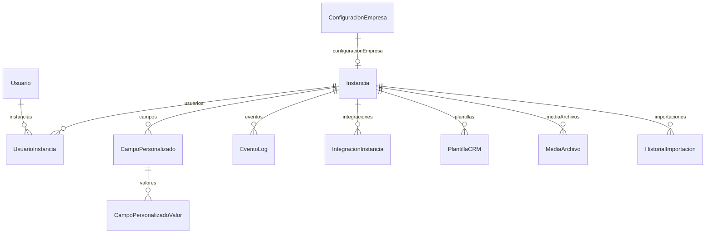
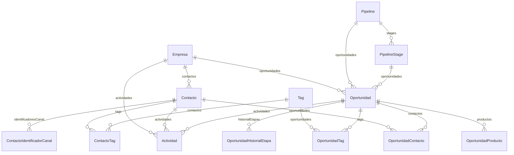
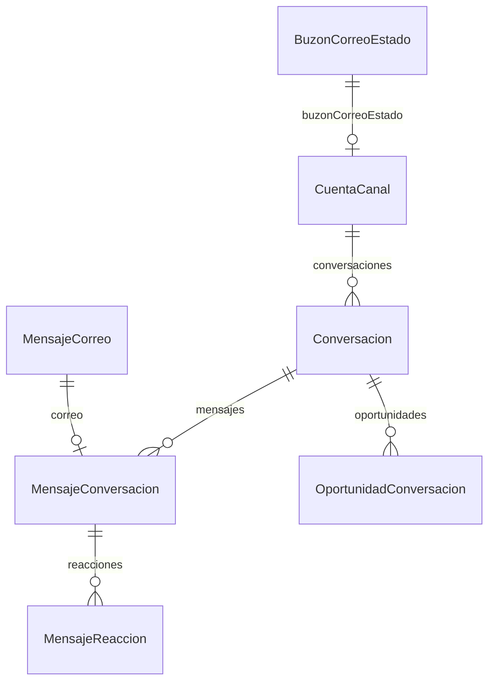
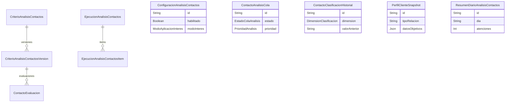
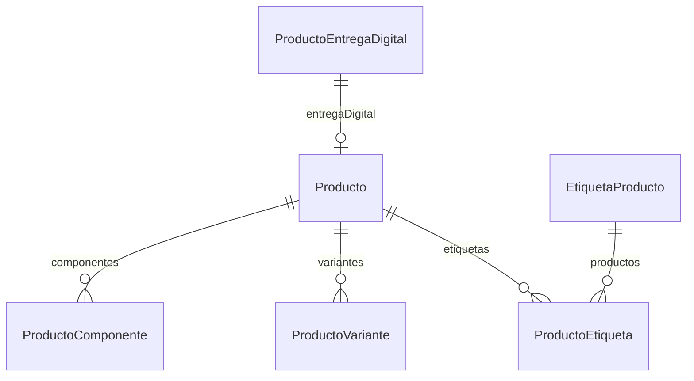
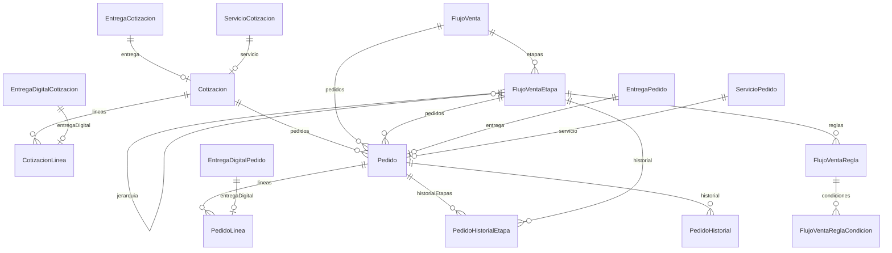
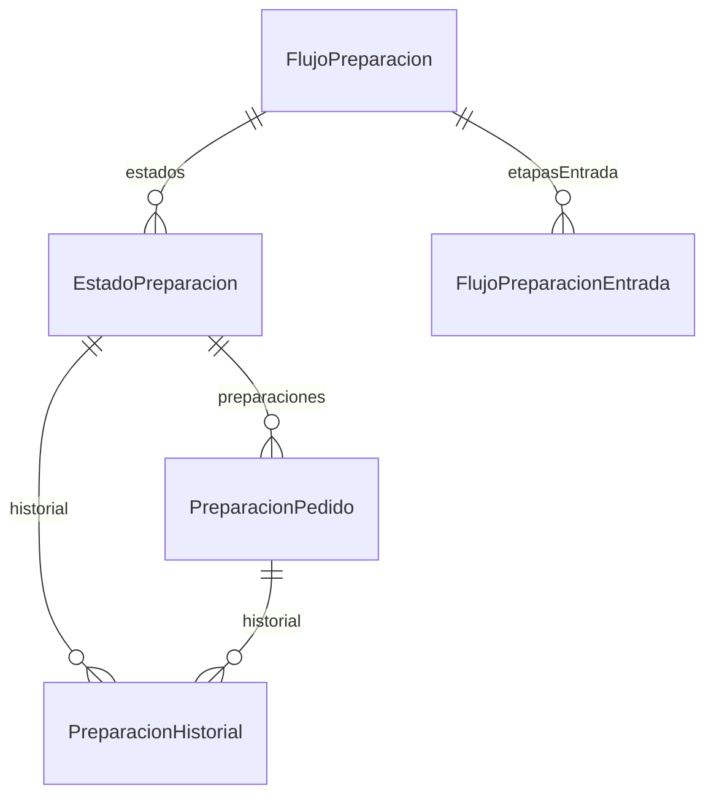
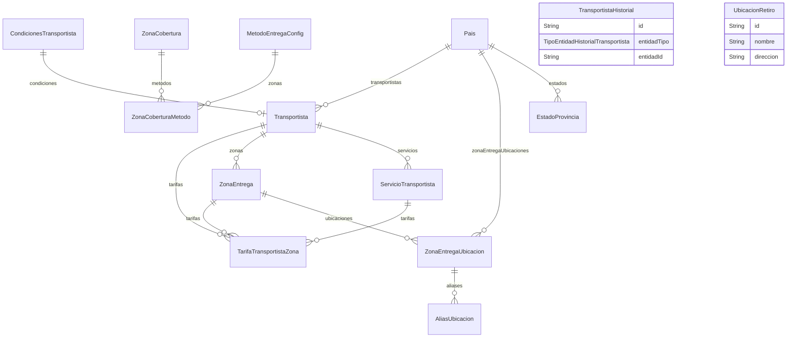
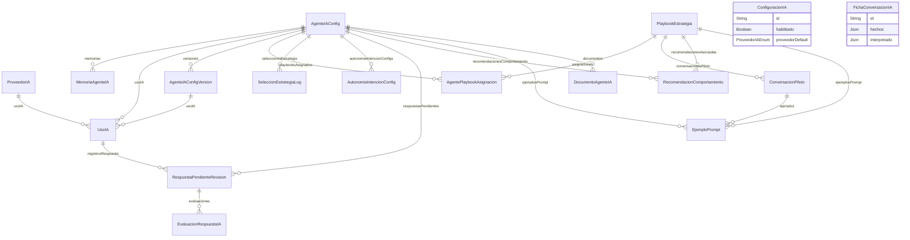
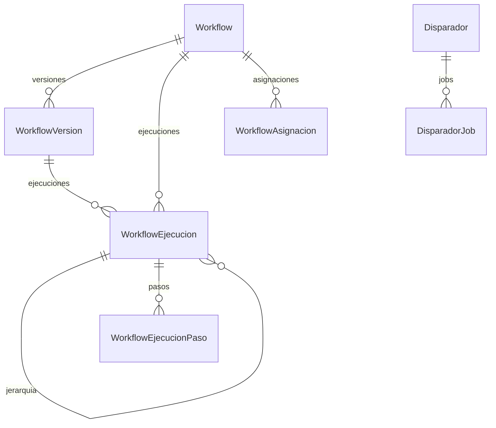

# Modelo de datos de Karia

Mapa del esquema de PostgreSQL: **106 modelos y 77 enums**, agrupados en diez dominios.

Los diagramas se generaron leyendo `prisma/schema.prisma`, no a mano, así que las relaciones son las reales. La fuente de verdad sigue siendo el esquema: si algo no coincide, manda el esquema y este documento está viejo.

## Cómo leer esto

Cada dominio trae un diagrama entidad-relación y la lista de sus cruces con otros dominios. Notación:

| Símbolo | Significa |
|---|---|
| `A \|\|--o{ B` | Un A tiene muchos B |
| `A \|\|--o\| B` | Un A tiene como mucho un B (extensión 1:1) |

**Los diagramas omiten `Instancia`** salvo en el primero. Son 64 flechas que no aportan nada y tapan todo lo demás; asumí que todo cuelga de ella.

## La regla que atraviesa todo el esquema

Karia es multi-tenant. **Toda consulta y toda escritura de negocio va filtrada por `instanciaId`** — es la regla de seguridad más repetida del proyecto y la que más caro sale olvidar.

| | Modelos |
|---|---|
| Con `instanciaId` propio | 64 |
| Que lo heredan por su padre | 38 |
| Catálogos globales (`Pais`, `EstadoProvincia`) | 2 |
| Casos aparte (`Instancia`, `Usuario`) | 2 |
| **Total** | **106** |

Que un modelo no tenga la columna **no significa que sea global**: una `PedidoLinea` pertenece al tenant de su `Pedido`. Solo `Pais` y `EstadoProvincia` se comparten de verdad, y `Usuario` es el caso aparte — una persona puede estar en varias cuentas, y la pertenencia vive en `UsuarioInstancia`.

## Los diez dominios

| Dominio | Modelos | De qué se ocupa |
|---|---|---|
| [Identidad y cuenta](#identidad-y-cuenta) | 11 | Tenant, usuarios, roles, configuración, campos a medida |
| [CRM](#crm) | 13 | Contactos, empresas, oportunidades, pipeline, actividades |
| [Conversaciones y canales](#conversaciones-y-canales) | 7 | Buzones conectados, conversaciones, mensajes |
| [Análisis de contactos](#análisis-de-contactos) | 10 | Segmentación comercial por reglas e IA |
| [Productos](#productos) | 6 | Catálogo, combos, variantes, entrega digital |
| [Ventas](#ventas) | 16 | Cotizaciones, pedidos, flujo de venta configurable |
| [Preparación de pedidos](#preparación-de-pedidos) | 5 | Tablero operativo posterior a la venta |
| [Envíos y cobertura](#envíos-y-cobertura) | 14 | Transportistas, zonas, tarifas, cobertura geográfica |
| [Agente IA](#agente-ia) | 17 | Agente, memoria, documentación, autonomía, consumo |
| [Automatización](#automatización) | 7 | Disparadores y motor de workflows |

---

## Identidad y cuenta

**11 modelos.**

`Instancia` es la raíz del multi-tenant: **todo dato de negocio cuelga de ella**, directa o indirectamente. De los 106 modelos, 64 llevan `instanciaId` como columna propia y otros 38 lo heredan por su padre (una `PedidoLinea` es del tenant de su `Pedido`). Quedan cuatro fuera: dos catálogos globales (`Pais`, `EstadoProvincia`) y dos casos aparte — la propia `Instancia` y `Usuario`.

`Usuario` es el único modelo de negocio **sin** `instanciaId`, y es a propósito: una persona puede pertenecer a varias cuentas. La pertenencia vive en `UsuarioInstancia`, que es donde está el rol.

`CampoPersonalizado` / `CampoPersonalizadoValor` son el mecanismo genérico de campos a medida: un mismo par sirve a Contacto, Empresa, Oportunidad, Cotización y Pedido.

> **Ojo:** El diagrama omite las flechas de `Instancia` hacia los otros dominios: son 64 y lo volverían ilegible. Asumí que todo lo que sigue cuelga de ella.

**Cruces con otros dominios**

- *Agente IA* — `Usuario → AgenteIAConfig`, `Usuario → AgenteIAConfigVersion`, `Usuario → ConversacionPiloto`, `Usuario → RecomendacionComportamiento`
- *CRM* — `CampoPersonalizado → Pipeline`, `CampoPersonalizado → PipelineStage`, `CampoPersonalizadoValor → Contacto`, `CampoPersonalizadoValor → Empresa`, `CampoPersonalizadoValor → Oportunidad`, `MediaArchivo → Contacto`, `Usuario → Actividad`, `Usuario → Contacto`, `Usuario → Empresa`, `Usuario → Oportunidad`, `UsuarioInstancia → Actividad`, `UsuarioInstancia → Contacto`, `UsuarioInstancia → Empresa`, `UsuarioInstancia → Oportunidad`
- *Conversaciones y canales* — `MediaArchivo → MensajeConversacion`
- *Envíos y cobertura* — `ConfiguracionEmpresa → Pais`
- *Preparación de pedidos* — `Usuario → PreparacionPedido`
- *Ventas* — `CampoPersonalizadoValor → Cotizacion`, `CampoPersonalizadoValor → Pedido`, `Usuario → Cotizacion`, `Usuario → Pedido`, `Usuario → PedidoLinea`, `UsuarioInstancia → Cotizacion`, `UsuarioInstancia → Pedido`

---

## CRM

**13 modelos.**

El núcleo comercial. `Contacto` y `Empresa` son las entidades de relación; `Oportunidad` es la de proceso, y se mueve por un `Pipeline` compuesto de `PipelineStage`.

Dos detalles que el diagrama no grita:

- **`Oportunidad` ↔ `Contacto` es N:N** (`OportunidadContacto`), con un contacto marcado como principal. No es una oportunidad por contacto.
- **`OportunidadHistorialEtapa` es la bitácora de movimientos del pipeline.** Es lo que permite medir tiempo por etapa; sin ella el dato se perdería en cada movimiento.
- `ContactoIdentificadorCanal` es la pieza que une un contacto con su identidad en cada canal (teléfono de WhatsApp, usuario de Instagram, dirección de correo). Ahí vive también `aprobadoEn`, la fuente de verdad del bloqueo por aprobación de remitente.

**Cruces con otros dominios**

- *Agente IA* — `PipelineStage → AgenteIAConfig`
- *Análisis de contactos* — `Contacto → ContactoAnalisisCola`, `Contacto → ContactoClasificacionHistorial`, `Contacto → ContactoEvaluacion`, `Contacto → PerfilClienteSnapshot`
- *Automatización* — `Oportunidad → DisparadorJob`, `Oportunidad → WorkflowEjecucion`, `Pipeline → Disparador`, `Pipeline → WorkflowAsignacion`, `PipelineStage → Disparador`, `PipelineStage → WorkflowAsignacion`
- *Conversaciones y canales* — `Contacto → Conversacion`, `Oportunidad → Conversacion`, `Oportunidad → OportunidadConversacion`, `Pipeline → CuentaCanal`, `PipelineStage → CuentaCanal`
- *Identidad y cuenta* — `Actividad → Usuario`, `Actividad → UsuarioInstancia`, `Contacto → CampoPersonalizadoValor`, `Contacto → MediaArchivo`, `Contacto → Usuario`, `Contacto → UsuarioInstancia`, `Empresa → CampoPersonalizadoValor`, `Empresa → Usuario`, `Empresa → UsuarioInstancia`, `Oportunidad → CampoPersonalizadoValor`, `Oportunidad → Usuario`, `Oportunidad → UsuarioInstancia`, `Pipeline → CampoPersonalizado`, `PipelineStage → CampoPersonalizado`
- *Productos* — `OportunidadProducto → Producto`
- *Ventas* — `Actividad → Cotizacion`, `Actividad → Pedido`, `Contacto → Cotizacion`, `Contacto → Pedido`, `Empresa → Cotizacion`, `Empresa → Pedido`, `Oportunidad → Cotizacion`, `Oportunidad → Pedido`

---

## Conversaciones y canales

**7 modelos.**

`CuentaCanal` es un buzón conectado: una cuenta de WhatsApp, una página de Messenger, un usuario de Instagram o una casilla de correo IMAP/SMTP. Sus credenciales viven cifradas en `configuracion`.

`Conversacion` agrupa los `MensajeConversacion` de un contacto en un canal. `MensajeCorreo` es la extensión 1:1 para correo, donde vive el **HTML ya limpio** — el original nunca se guarda.

`OportunidadConversacion` es la tabla puente: una conversación puede alimentar varias oportunidades a lo largo del tiempo.

> **Ojo:** `Conversacion.bloqueadaPorAprobacion` y `modoAtencion` son banderas **derivadas**. La fuente de verdad del bloqueo es `ContactoIdentificadorCanal.aprobadoEn`; estas se escriben en la misma transacción y existen para no hacer un join en cada render.

**Cruces con otros dominios**

- *Agente IA* — `Conversacion → ConversacionPiloto`, `Conversacion → FichaConversacionIA`, `Conversacion → RespuestaPendienteRevision`, `Conversacion → SeleccionEstrategiaLog`
- *Automatización* — `Conversacion → WorkflowEjecucion`
- *CRM* — `Conversacion → Contacto`, `Conversacion → Oportunidad`, `CuentaCanal → Pipeline`, `CuentaCanal → PipelineStage`, `OportunidadConversacion → Oportunidad`
- *Identidad y cuenta* — `MensajeConversacion → MediaArchivo`

---

## Análisis de contactos

**10 modelos.**

Agregado en las specs 041 y 042. Califica contactos por reglas y, cuando hace falta, con IA.

La pieza que explica el diseño es **`ContactoAnalisisCola`**: una fila por contacto, con versión monótona, ventana de agrupación y reintentos. No es una cola en memoria ni en RabbitMQ — es durable en PostgreSQL, para que un reinicio del worker no pierda trabajo pendiente.

`ContactoEvaluacion` guarda el resultado; `EjecucionAnalisisContactos` + `...Item` son la auditoría por intento, con retención de 90 días. `CriterioAnalisisContactos` y su `...Version` permiten cambiar el criterio sin reescribir lo ya evaluado.

Sobre el propio `Contacto` quedan materializados `nivelInteres`, `nivelInteresOrigen`, `nivelInteresFijado` y `puntajeComercial`: lo que se consulta en listados y filtros.

> **Ojo:** `nivelInteresFijado` es el que distingue una clasificación puesta a mano de una calculada. Si lo ignorás en una consulta, el próximo análisis pisa la decisión de un humano.

**Cruces con otros dominios**

- *Agente IA* — `EjecucionAnalisisContactos → ProveedorIA`
- *CRM* — `ContactoAnalisisCola → Contacto`, `ContactoClasificacionHistorial → Contacto`, `ContactoEvaluacion → Contacto`, `PerfilClienteSnapshot → Contacto`

---

## Productos

**6 modelos.**

Chico pero con dos capacidades que se cruzan:

- **Combos** (`ProductoComponente`): un producto puede estar compuesto por otros. El stock que se consume es el de los componentes, no el del combo.
- **Variantes** (`ProductoVariante`): un producto con variantes no se vende sin elegir una, y el stock es el de la variante.
- `ProductoEntregaDigital` marca los productos que no se envían: se entregan por un enlace o un archivo.

> **Ojo:** Al tocar stock hay que mirar las tres: un combo con variantes consume el stock de las variantes de sus componentes.

**Cruces con otros dominios**

- *Agente IA* — `Producto → ConversacionPiloto`, `Producto → EjemploPrompt`, `Producto → RespuestaPendienteRevision`
- *CRM* — `Producto → OportunidadProducto`
- *Ventas* — `Producto → CotizacionLinea`, `Producto → PedidoLinea`, `ProductoVariante → CotizacionLinea`, `ProductoVariante → PedidoLinea`

---

## Ventas

**16 modelos.**

`Cotizacion` → `Pedido` es el camino principal; un pedido también puede nacer suelto. Ambos repiten la misma estructura de tres satélites 1:1 — `Entrega…`, `Servicio…` y `EntregaDigital…` por línea — porque una cotización tiene que poder congelar sus datos de envío sin depender de que el pedido exista todavía.

**`FlujoVenta` es la parte que conviene entender antes de tocar nada.** Reemplaza al enum `Pedido.estado` por un flujo configurable: `FlujoVentaEtapa` (jerárquica, con `parentId`) define las etapas y sus banderas —`esFinal`, `esCancelacion`, `cuentaComoVenta`, `permiteEditarPedido`—, y `FlujoVentaRegla` + `...Condicion` son las validaciones para pasar de una a otra.

El enum `estado` sigue existiendo y **queda congelado desde la creación** cuando hay flujo dinámico. Usarlo para calcular algo en una instancia con flujo configurado da números equivocados.

> **Ojo:** `Pedido` tiene **tres ejes de fecha** y cada KPI usa el suyo: `fechaPedido` (el listado), `fechaEntrega` (pendientes y expirados) y `fechaVenta` (totales de venta). Equivocarse de eje no rompe nada visible: solo da un número mal.

**Cruces con otros dominios**

- *Automatización* — `FlujoVenta → Disparador`, `FlujoVentaEtapa → Disparador`, `Pedido → DisparadorJob`
- *CRM* — `Cotizacion → Actividad`, `Cotizacion → Contacto`, `Cotizacion → Empresa`, `Cotizacion → Oportunidad`, `Pedido → Actividad`, `Pedido → Contacto`, `Pedido → Empresa`, `Pedido → Oportunidad`
- *Envíos y cobertura* — `EntregaCotizacion → EstadoProvincia`, `EntregaCotizacion → Pais`, `EntregaCotizacion → ServicioTransportista`, `EntregaCotizacion → TarifaTransportistaZona`, `EntregaCotizacion → Transportista`, `EntregaCotizacion → ZonaEntrega`, `EntregaPedido → EstadoProvincia`, `EntregaPedido → Pais`, `EntregaPedido → ServicioTransportista`, `EntregaPedido → TarifaTransportistaZona`, `EntregaPedido → Transportista`, `EntregaPedido → ZonaEntrega`
- *Identidad y cuenta* — `Cotizacion → CampoPersonalizadoValor`, `Cotizacion → Usuario`, `Cotizacion → UsuarioInstancia`, `Pedido → CampoPersonalizadoValor`, `Pedido → Usuario`, `Pedido → UsuarioInstancia`, `PedidoLinea → Usuario`
- *Preparación de pedidos* — `FlujoVentaEtapa → FlujoPreparacionEntrada`, `Pedido → PreparacionPedido`
- *Productos* — `CotizacionLinea → Producto`, `CotizacionLinea → ProductoVariante`, `PedidoLinea → Producto`, `PedidoLinea → ProductoVariante`

---

## Preparación de pedidos

**5 modelos.**

Tablero operativo posterior a la venta (spec 026). `FlujoPreparacion` define los `EstadoPreparacion` por los que pasa cada `PreparacionPedido`, y `FlujoPreparacionEntrada` dice **qué etapas del flujo de venta hacen entrar un pedido** a preparación.

Es un flujo paralelo al de venta, no una continuación: un pedido puede estar en "Confirmado" para ventas y en "Empacando" para preparación al mismo tiempo.

**Cruces con otros dominios**

- *Identidad y cuenta* — `PreparacionPedido → Usuario`
- *Ventas* — `FlujoPreparacionEntrada → FlujoVentaEtapa`, `PreparacionPedido → Pedido`

---

## Envíos y cobertura

**14 modelos.**

El dominio más grande después de IA, y el que más gente subestima.

`Transportista` tiene `ServicioTransportista` (modalidades) y `ZonaEntrega` (áreas), y el precio sale del cruce de los dos en `TarifaTransportistaZona`. `ZonaEntregaUbicacion` baja la zona a ubicaciones concretas, y `AliasUbicacion` resuelve que un cliente escriba "Surco" y la tarifa esté cargada como "Santiago de Surco".

`MetodoEntregaConfig` + `ZonaCobertura` + `ZonaCoberturaMetodo` son la capa de cobertura geográfica: qué métodos de entrega existen y dónde llegan.

`Pais` y `EstadoProvincia` son los únicos **catálogos globales** del esquema: no tienen `instanciaId` y se comparten entre todas las cuentas.

> **Ojo:** `CondicionesTransportista` es 1:1 con el transportista y guarda las restricciones (peso, volumen, valor declarado) que deciden si un envío es viable.

**Cruces con otros dominios**

- *Identidad y cuenta* — `Pais → ConfiguracionEmpresa`
- *Ventas* — `EstadoProvincia → EntregaCotizacion`, `EstadoProvincia → EntregaPedido`, `Pais → EntregaCotizacion`, `Pais → EntregaPedido`, `ServicioTransportista → EntregaCotizacion`, `ServicioTransportista → EntregaPedido`, `TarifaTransportistaZona → EntregaCotizacion`, `TarifaTransportistaZona → EntregaPedido`, `Transportista → EntregaCotizacion`, `Transportista → EntregaPedido`, `ZonaEntrega → EntregaCotizacion`, `ZonaEntrega → EntregaPedido`

---

## Agente IA

**17 modelos.**

El dominio con más modelos (17), y el que más cambió entre las specs 009 y 018.

`AgenteIAConfig` es el agente de una cuenta, versionado en `AgenteIAConfigVersion` para que un cambio de prompt no reescriba el historial. `ProveedorIA` guarda las credenciales por tenant (cifradas) y permite elegir proveedor por objetivo.

- `MemoriaAgenteIA` y `FichaConversacionIA`: lo que el agente recuerda entre conversaciones.
- `DocumentoAgenteIA`: los archivos que el negocio sube. El contenido **no** está en PostgreSQL — vive en un vector store de OpenAI por instancia (`Instancia.vectorStoreDocumentacionId`); acá solo quedan los metadatos.
- `PlaybookEstrategia` + `AgentePlaybookAsignacion` + `SeleccionEstrategiaLog`: qué estrategia comercial usa el agente y por qué eligió la que eligió.
- `AutonomiaIntencionConfig` + `RespuestaPendienteRevision` + `EvaluacionRespuestaIA`: el nivel de autonomía por intención y la cola de revisión humana.
- `UsoIA`: consumo de tokens por tarea. Es la tabla de costos.

> **Ojo:** Los identificadores de OpenAI (`vectorStoreId`, `openaiFileId`) **nunca** salen al cliente. El aislamiento entre cuentas es físico: el índice de un comercio no contiene bytes de otro.

**Cruces con otros dominios**

- *Análisis de contactos* — `ProveedorIA → EjecucionAnalisisContactos`
- *CRM* — `AgenteIAConfig → PipelineStage`
- *Conversaciones y canales* — `ConversacionPiloto → Conversacion`, `FichaConversacionIA → Conversacion`, `RespuestaPendienteRevision → Conversacion`, `SeleccionEstrategiaLog → Conversacion`
- *Identidad y cuenta* — `AgenteIAConfig → Usuario`, `AgenteIAConfigVersion → Usuario`, `ConversacionPiloto → Usuario`, `RecomendacionComportamiento → Usuario`
- *Productos* — `ConversacionPiloto → Producto`, `EjemploPrompt → Producto`, `RespuestaPendienteRevision → Producto`

---

## Automatización

**7 modelos.**

Dos mecanismos que conviven y se confunden seguido:

- **`Disparador` / `DisparadorJob`**: el mecanismo simple y más viejo. Una condición, una acción, un job encolado.
- **`Workflow` / `WorkflowVersion` / `WorkflowEjecucion` / `WorkflowEjecucionPaso`**: el motor de flujos, con versiones publicadas, ejecuciones y un paso registrado por nodo visitado.

`WorkflowAsignacion` dice a qué pipeline o etapa aplica cada workflow.

> **Ojo:** `WorkflowEjecucion.claveIdempotencia` es lo que evita que el mismo disparo cree dos ejecuciones. Todo disparo nuevo tiene que aportar una clave estable, o un reintento duplica el trabajo.

**Cruces con otros dominios**

- *CRM* — `Disparador → Pipeline`, `Disparador → PipelineStage`, `DisparadorJob → Oportunidad`, `WorkflowAsignacion → Pipeline`, `WorkflowAsignacion → PipelineStage`, `WorkflowEjecucion → Oportunidad`
- *Conversaciones y canales* — `WorkflowEjecucion → Conversacion`
- *Ventas* — `Disparador → FlujoVenta`, `Disparador → FlujoVentaEtapa`, `DisparadorJob → Pedido`

---

## Lo que el esquema no te dice

Cinco reglas que no se ven en ningún diagrama y que explican por qué varias consultas están escritas como están. Cada una tiene su documento con el detalle.

### 1. "Cuenta como venta" se deriva, nunca se persiste

Qué pedidos suman en "Total ventas" sale de leer `FlujoVentaEtapa.cuentaComoVenta` **en cada consulta**. Por eso marcar o desmarcar una etapa cambia los totales en el siguiente render, sin recálculo ni migración.

Copiar ese flag al `Pedido` "para optimizar" destruye esa garantía entera. Detalle: `specs/038-cuenta-como-venta/`.

### 2. `Pedido.fechaVenta` se sella una sola vez

Es el caso contrario al anterior: esta fecha **sí** se materializa, la primera vez que el pedido entra a una etapa marcada `cuentaComoVenta`. Avanzar después a otra etapa que también cuenta no la mueve; volver a una que no cuenta no la borra.

Se escribe siempre en el mismo `update` que `flujoVentaEtapaId`, en la misma transacción. Son cuatro sitios en el código; **un quinto que no la selle deja pedidos fuera de todo total filtrado por rango, sin ningún error**.

### 3. Todo timestamp se guarda en UTC, y hay dos zonas distintas

- **Zona de negocio** (`ConfiguracionEmpresa.zonaHoraria`): única fuente válida para rangos de día, filtros, KPIs y cuotas. Si un valor llega a un `where` de Prisma, viene de acá.
- **Zona de presentación** (usuario → empresa → navegador → UTC): solo para formatear en pantalla. Nunca entra en una consulta.

Confundirlas es el error clásico del proyecto. Filtros siempre con rangos semiabiertos `{ gte, lt }`. Detalle: `docs/fechas-y-zonas-horarias.md`.

### 4. La documentación del agente no está en PostgreSQL

`DocumentoAgenteIA` guarda metadatos. El contenido vive en un vector store de OpenAI por instancia (`Instancia.vectorStoreDocumentacionId`). El aislamiento entre cuentas es **físico**: el índice de un comercio no contiene bytes de otro.

Detalle: `docs/documentacion-agente-aislamiento.md`.

### 5. El bloqueo por aprobación de remitente corta en tres lugares

La fuente de verdad es `ContactoIdentificadorCanal.aprobadoEn`. Las banderas de `Conversacion` y `Oportunidad` son derivadas, escritas en la misma transacción. El corte se aplica en envío, en el orquestador de IA y en el motor de Workflows — **tocar uno solo deja un agujero**.

Detalle: `specs/034-canal-correo-electronico/`.

---

## Regenerar este documento

Los diagramas salen de `prisma/schema.prisma`. Si agregás modelos o relaciones, hay que rehacerlos: el documento no se actualiza solo y un diagrama viejo es peor que ninguno.

La agrupación por dominio sí es editorial —no está en el esquema— así que un modelo nuevo hay que asignarlo a mano al dominio que le corresponda.
